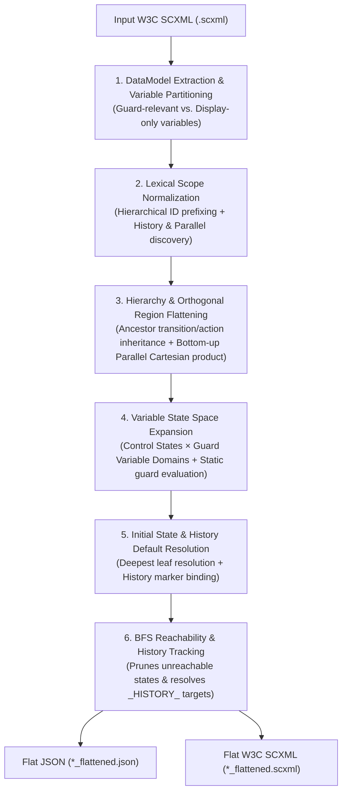
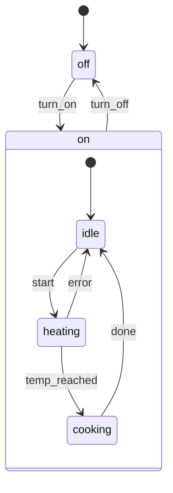
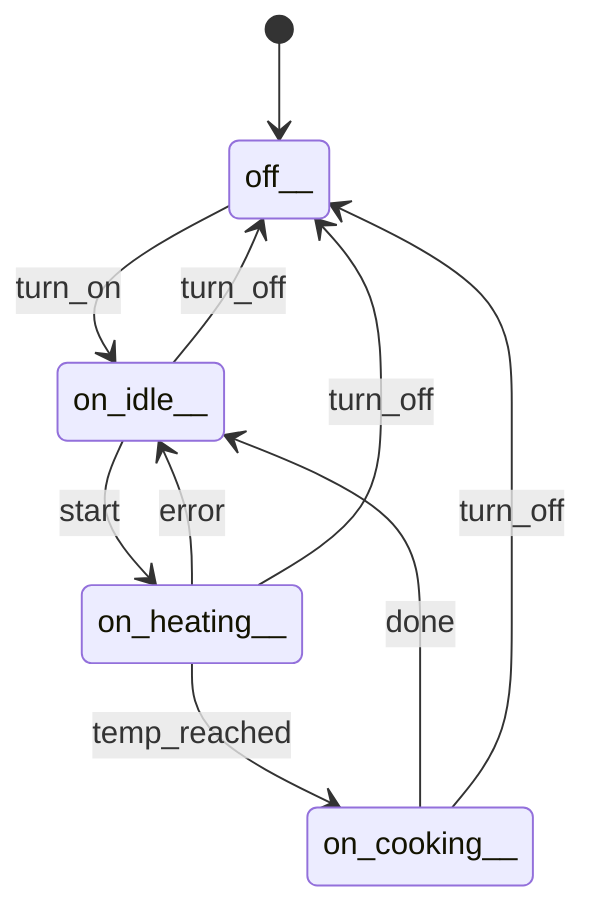
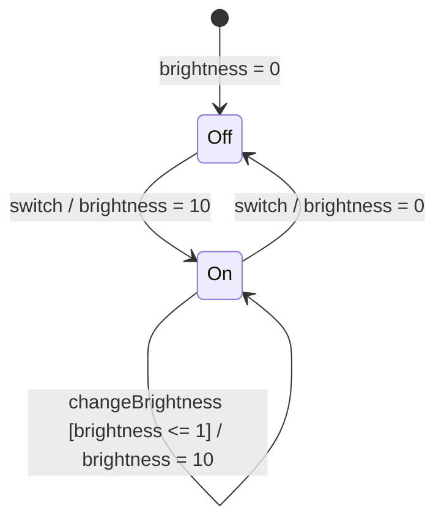
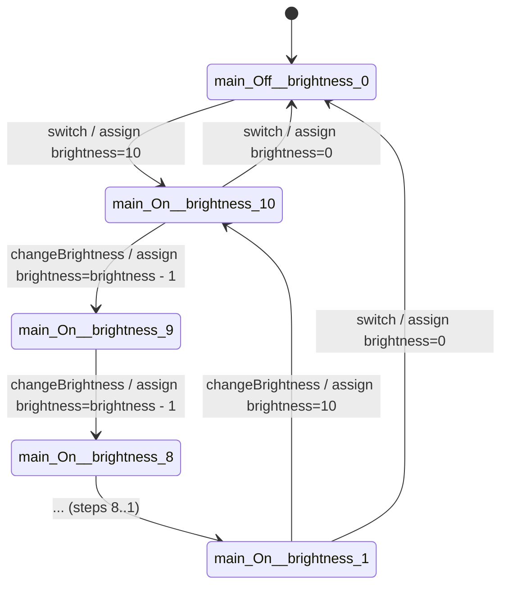
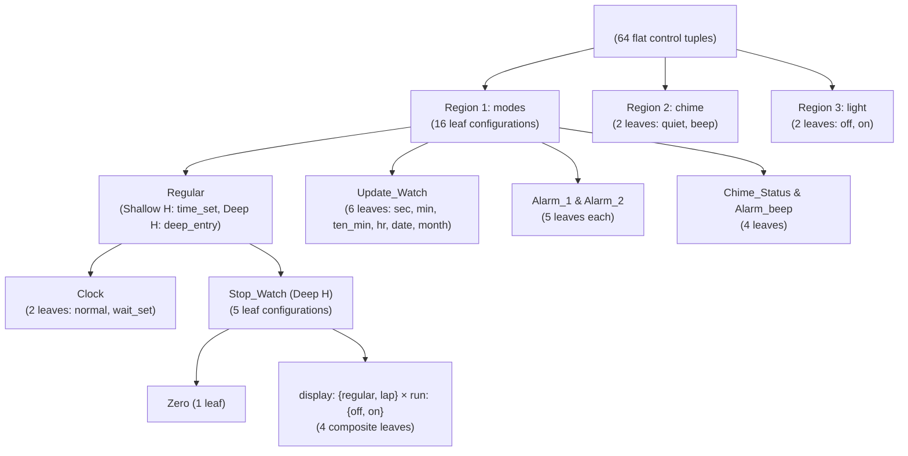

# StatechartFlattener

**`statechart_flattener`** is an Elixir-based model-to-model compiler that transforms hierarchical, concurrent, data-driven, and history-aware Harel Statecharts (encoded in W3C **SCXML**) into semantically equivalent **Flat Finite-State Machines (FSMs)** in both **JSON** and **flat W3C SCXML** formats.

It is designed primarily to bridge visual/hierarchical statechart specifications (such as models built in **itemis CREATE / YAKINDU**) with downstream **Tabular Reinforcement Learning (Q-Learning)** agents, model checkers, and automated FSM testing pipelines that require an explicit flat state space $M_{\text{flat}} = (Q, \Sigma, \Gamma, \delta, \lambda, q_0)$.

---

## Key Capabilities & Algorithm Overview

Transforming full-featured Harel Statecharts into a deterministic flat FSM requires resolving five core statechart formalisms. The compiler (`lib/scxml_flattener_full.exs`) executes an automated multi-stage pipeline:



1. **OR-State Hierarchy & Lexical Scoping**: Flattens nested `<state>` hierarchies to atomic leaf states, prefixes IDs with their ancestor path (`parent_child_leaf`) to prevent naming collisions across regions, resolves composite initial targets (`.entry_0` / `<initial>`), and inherits ancestor transitions, `<onentry>`, and `<onexit>` actions.
2. **AND-State Orthogonality (`<parallel>`)**: Composes concurrent regions bottom-up via Cartesian product, synchronizes shared events across regions, and evaluates cross-region `In(...)` state predicates.
3. **DataModel Partitioning & Guard Evaluation (`<datamodel>`)**: Analyses transition `cond` expressions to partition `<data>` variables into **guard-relevant** variables (expanded into discrete state coordinates) and **display-only** variables (excluded from state explosion, reducing variable combinations in complex models like Harel's Watch from $2^{14}$ to $2^7$).
4. **Shallow & Deep History (`<history>`)**: Tracks active sub-configurations across transitions and resolves `<history>` pseudo-states during forward Breadth-First Search (BFS) reachability analysis.
5. **W3C Priority & RL Readiness**: Enforces inner-first / document-order transition priority so child transitions shadow conflicting ancestor transitions, normalizes eventless transitions to `"_auto"`, and prunes unreachable states.

---

## Demonstration Statechart Figures & Results

### Example 1: Flattening an OR-State Hierarchy (`lib/hierarchical_machine.scxml`)

In this model, a composite state `on` (with initial substate `idle`) contains three substates (`idle`, `heating`, `cooking`) and defines a high-level transition `turn_off -> off`.

#### Before Flattening (Hierarchical Statechart)



#### After Flattening (Flat FSM — 4 States, 8 Transitions)

The composite state `on` is eliminated. Its initial target (`turn_on -> on`) is resolved directly to the leaf state `on_idle__`, and its high-level `turn_off -> off__` transition is inherited by every leaf substate (`on_idle__`, `on_heating__`, `on_cooking__`):



<details>
<summary><b>View Generated Flat SCXML & JSON Output</b></summary>

**Flat SCXML (`lib/hierarchical_machine_full.scxml`)**:
```xml
<scxml version="1.0" initial="off__" xmlns="http://www.w3.org/2005/07/scxml">
  <state id="off__">
    <transition target="on_idle__" event="turn_on"/>
  </state>
  <state id="on_cooking__">
    <transition target="on_idle__" event="done"/>
    <transition target="off__" event="turn_off"/>
  </state>
  <state id="on_heating__">
    <transition target="on_idle__" event="error"/>
    <transition target="on_cooking__" event="temp_reached"/>
    <transition target="off__" event="turn_off"/>
  </state>
  <state id="on_idle__">
    <transition target="on_heating__" event="start"/>
    <transition target="off__" event="turn_off"/>
  </state>
</scxml>
```

**Flat JSON (`lib/hierarchical_machine_full.json`)**:
```json
{
  "initial": "off__",
  "states": [
    {
      "state": "off__",
      "transitions": [
        { "input": "turn_on", "output": [], "target": "on_idle__" }
      ]
    },
    {
      "state": "on_cooking__",
      "transitions": [
        { "input": "done", "output": [], "target": "on_idle__" },
        { "input": "turn_off", "output": [], "target": "off__" }
      ]
    },
    {
      "state": "on_heating__",
      "transitions": [
        { "input": "error", "output": [], "target": "on_idle__" },
        { "input": "temp_reached", "output": [], "target": "on_cooking__" },
        { "input": "turn_off", "output": [], "target": "off__" }
      ]
    },
    {
      "state": "on_idle__",
      "transitions": [
        { "input": "start", "output": [], "target": "on_heating__" },
        { "input": "turn_off", "output": [], "target": "off__" }
      ]
    }
  ]
}
```
</details>

---

### Example 2: Data Variables & Guarded Transitions (`_02_DimmableLightSwitch.scxml`)

In `lib/original_scxml/_02_DimmableLightSwitch.scxml`, a `<data id="brightness" expr="0"/>` variable controls guarded transitions on the `changeBrightness` event (`cond="brightness > 1"` vs. `cond="brightness <= 1"`).

#### Before Flattening (Guarded Statechart)



#### After Flattening (Unrolled Variable-Expanded FSM)

The compiler infers the domain of `brightness`, evaluates the guards statically for each valuation, and unrolls the variable into explicit flat states without runtime guard conditions:



---

### Example 3: Nested Orthogonal Regions & History — Harel's Citizen Quartz Watch (`harel_watch/watch.scxml`)

David Harel's canonical 1987 **Citizen Quartz Multi-Alarm III Wristwatch** (`harel_watch/watch.scxml`, 335 lines) combines 3 top-level concurrent regions (`modes`, `chime`, `light`), a nested `<parallel id="Operation">` stopwatch sub-machine (`display` $\times$ `run`), 3 shallow/deep `<history>` pseudo-states, and 14 `<data>` variables.



- **Control space**: $16 \times 2 \times 2 = \mathbf{64}$ parallel control tuples.
- **Variable partitioning**: 14 variables partitioned into **7 guard-relevant** ($2^7 = 128$ combinations) and **7 display-only** (pruned from state IDs), yielding $64 \times 128 = \mathbf{8,192}$ base expanded states.
- **Reachability & History synthesis**: Forward BFS prunes unreachable variable combinations (leaving **3,072** reachable base states) and synthesizes **23,040** history-preserving product states with **232,704** deterministic transitions and **0** broken targets.

---

### Benchmark Summary Across Repository Models

| Benchmark Model | Source Path | SCXML Features | `<state>` / `<parallel>` / `<history>` | Guard / Total Vars | Flattened States ($|Q|$) | Flattened Transitions ($|\delta|$) | Broken / Null / ND Defects |
| :--- | :--- | :--- | :---: | :---: | :---: | :---: | :---: |
| **`hierarchical_machine`** | `lib/hierarchical_machine.scxml` | OR-state hierarchy | 5 / 0 / 0 | 0 / 0 | **4** | **8** | `0 / 0 / 0` |
| **`_01_LightSwitch`** | `lib/original_scxml/_01_LightSwitch.scxml` | Basic composite wrapper | 3 / 0 / 0 | 0 / 0 | **2** | **2** | `0 / 0 / 0` |
| **`_02_DimmableLightSwitch`** | `lib/original_scxml/_02_DimmableLightSwitch.scxml` | `<datamodel>` + guarded self-loops | 3 / 0 / 0 | 1 / 1 | **21** *(full)* / **3** *(snapped)* | **31** | `0 / 0 / 0` |
| **`_03_MotionLightSwitch`** | `lib/original_scxml/_03_MotionLightSwitch.scxml` | Hierarchy + `.entry_0` pseudo-states | 7 / 0 / 0 | 1 / 1 | **43** *(full)* / **7** *(snapped)* | **107** | `0 / 0 / 0` |
| **`_04_LightAndMotionSensing`** | `lib/original_scxml/_04_LightAndMotionSensingLightSwitch.scxml` | 4 shallow `<history>` + display vars | 13 / 0 / 4 | 1 / 3 | **76** *(static)* / **126** *(dynamic)* | **250** | `0 / 0 / 0` |
| **`_05_PresenceSimulation`** | `lib/original_scxml/_05_PresenceSimulationLightSwitch.scxml` | `<parallel>` + `.choice_0` + time vars | 11 / 1 / 1 | 2 / 6 | **473** *(full)* / **77** *(snapped)* | **2,134** | `0 / 0 / 0` |
| **`Elevator`** | `statechart_with_integrations/Elevator.scxml` | Choice pseudo-states + guards | 5 / 0 / 0 | 2 / 2 | **3** | **4** | `0 / 0 / 0` |
| **`TrafficLightCtrl`** | `statechart_with_integrations/TrafficLightCtrl.scxml` | `<parallel>` + `In()` + deep history | 16 / 1 / 3 | 0 / 5 | **25** | **130** | `0 / 0 / 0` |
| **`watch` (Harel Watch)** | `harel_watch/watch.scxml` | Nested `<parallel>` + shallow/deep `<history>` + 14 vars | 30 / 2 / 3 | 7 / 14 | **3,072** *(static)* / **23,040** *(product)* | **26,624** / **232,704** | `0 / 0 / 0` |

---

## How to Use the Algorithm

### 1. Prerequisites

Ensure you have **Elixir (`~> 1.18`)** and **Erlang/OTP (`27+`)** installed.
- If you use [`mise`](https://mise.jdx.dev/), simply run:
  ```bash
  mise install
  ```
- Note: The standalone compiler scripts in `lib/` use `Mix.install/1` at startup to automatically fetch and cache required dependencies (`statifier`, `jason`, `xml_builder`), so they can be executed directly with the `elixir` CLI.

### 2. Running the Full Statechart Flattener (Recommended)

Use `lib/scxml_flattener_full.exs` to flatten statecharts containing hierarchy, `<parallel>` regions, `<datamodel>` variables/guards, and `<history>` states.

**Syntax**:
```bash
elixir lib/scxml_flattener_full.exs <input_scxml_path> <output_prefix_or_path>
```

The script automatically strips any extension from `<output_prefix_or_path>` and writes two files:
- `<output_prefix>_flattened.json`
- `<output_prefix>_flattened.scxml`

**Examples**:

```bash
# Flatten a simple hierarchical statechart
elixir lib/scxml_flattener_full.exs lib/hierarchical_machine.scxml lib/hierarchical_machine_out

# Flatten the progressive LightSwitch benchmark models (_01 through _05)
elixir lib/scxml_flattener_full.exs lib/original_scxml/_01_LightSwitch.scxml lib/generated_jsons/_01_LightSwitch
elixir lib/scxml_flattener_full.exs lib/original_scxml/_05_PresenceSimulationLightSwitch.scxml lib/generated_jsons/_05_PresenceSimulationLightSwitch

# Flatten Harel's Citizen Quartz Watch statechart
elixir lib/scxml_flattener_full.exs harel_watch/watch.scxml harel_watch/watch
```

**Sample Console Output**:
```text
ℹ️  Variables: ["brightness"]
ℹ️  Guard-relevant vars: ["brightness"]
ℹ️  Display-only vars: []
ℹ️  Mutable domains: ["brightness"]
ℹ️  History states: []
ℹ️  Parallel states: []
ℹ️  Flat states (before expansion): 2
ℹ️  Expanded states: 8
ℹ️  Initial state: main_Off__brightness_0
ℹ️  History defaults: %{}
ℹ️  States after reachability: 3
✅ Success!
   JSON:  lib/generated_jsons/_02_DimmableLightSwitch_flattened.json
   SCXML: lib/generated_jsons/_02_DimmableLightSwitch_flattened.scxml
```

### 3. Other Scripts & Utilities

- **Basic Pure-Hierarchy Flattener (`lib/flatten_scxml.exs`)**:
  Lightweight flattener for pure OR-state hierarchies without `<datamodel>`, `<parallel>`, or `<history>`. Outputs `<input_basename>_flat.json` and `<input_basename>_flat.scxml`:
  ```bash
  elixir lib/flatten_scxml.exs lib/hierarchical_machine.scxml
  ```
- **SCXML Parser & Validator (`lib/run_parser.exs`)**:
  Tests parsing and initializing an `.scxml` document via `Statifier`:
  ```bash
  elixir lib/run_parser.exs lib/hierarchical_machine.scxml
  ```
- **JSON Statistics Counter (`lib/generated_jsons/count_stats.py`)**:
  Computes total states and transitions across generated `*_flattened.json` files:
  ```bash
  python3 lib/generated_jsons/count_stats.py
  ```

---

## Output Format Specification

### State Naming Convention

Every state ID in the flattened output encodes the active control path and guard-relevant variable valuation separated by double underscores (`__`):

```text
<control_configuration>__<var1>_<val1>__<var2>_<val2>
```

- **Simple hierarchical leaf**: `on_heating__` (no guard variables) or `main_On__brightness_10`
- **Parallel composite leaf**: `<parallel_id>__<region1_leaf>__<region2_leaf>__<vars>`
  - Example: `modes_Active__modes_Active_schedule_Waiting__modes_Active_presence_Present__brightness_1__hour_8`

### Flat JSON Schema (`*_flattened.json`)

```json
{
  "initial": "<initial_state_id>",
  "states": [
    {
      "state": "<state_id>",
      "transitions": [
        {
          "input": "<event_name_or__auto>",
          "output": ["<onentry_onexit_or_transition_action>"],
          "target": "<target_state_id>"
        }
      ]
    }
  ]
}
```

---

## Documentation Vault

Detailed architectural notes, mathematical formulations, and benchmark analyses are available in the [`obsidian/`](./obsidian/00%20-%20Home%20&%20MOC.md) knowledge base:
- **01 — Architecture & Algorithms**: System motivation, compiler pipeline, lexical scoping, orthogonal region composition, datamodel partitioning, history synthesis, and transition priority.
- **02 — Chronology & Development History**: Git history and engineering session logs.
- **03 — Metrics, Benchmarks & Verification**: Master metrics dashboard, Progressive LightSwitch suite (`_01`–`_05`), Harel Watch case study, and formal verification suites.
- **04 — Analysis, Limitations & Roadmap**: Semantic equivalence analysis, edge cases, and future work.
