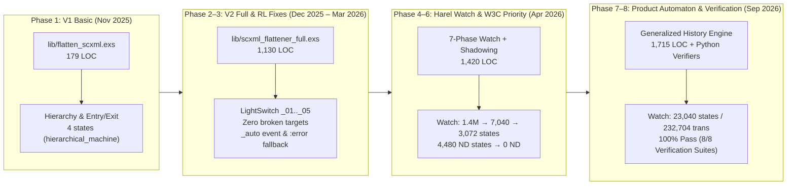

# Statechart Flattener — Project Knowledge Base & MOC

> [!IMPORTANT] Executive Summary
> **`statechart_flattener`** is an Elixir-based model-to-model compiler that transforms hierarchical, concurrent, data-driven, and history-aware Harel Statecharts (encoded in W3C **SCXML**) into semantically equivalent **Flat Finite-State Machines (FSMs)** in both **JSON** (tailored for Tabular Q-Learning and Reinforcement Learning agents) and **W3C SCXML** formats.
>
> Across **10 months of research and engineering** (November 2025 – September 2026), **14 Git commits** across 5 branches, and **8 intensive engineering phases**, the compiler evolved from a 179-line basic hierarchy flattener (`V1`) into a **1,715-line product-automaton synthesizer (`V3`)** capable of compiling David Harel's canonical **Citizen Quartz Multi-Alarm III Watch** (`watch.scxml`, 335 lines, 14 variables, nested orthogonal regions, and 3 history pseudo-states) into a **100% deterministic, formally verified 23,040-state / 232,704-transition FSM** in under 15 seconds.

---

## 🗺️ Vault Navigation (Map of Content)

### 01 — Architecture & Compilation Algorithms
1. [[1.1 - System Overview & Motivation|1.1 — System Overview & Motivation]]
   *Why flatten statecharts? Tabular RL compatibility, model checking, W3C SCXML semantics vs. Mealy/Moore flat FSMs.*
2. [[1.2 - Compiler Pipeline Architecture|1.2 — Compiler Pipeline Architecture]]
   *End-to-end 10-stage compilation pipeline in `lib/scxml_flattener_full.exs`, data structures, and complexity profile.*
3. [[1.3 - Lexical Normalization & Scope Resolution|1.3 — Lexical Normalization & Scope Resolution]]
   *Hierarchical path prefixing, anonymous `<parallel>` root wrapping (`_root`), LCA relative scoping, and global unique-suffix fallback.*
4. [[1.4 - Orthogonal Regions & Parallel Composition|1.4 — Orthogonal Regions & Parallel Composition]]
   *Bottom-up multi-level Cartesian product synthesis, synchronized inter-region events, cross-region `In(...)` guard evaluation, and region exit/entry rules.*
5. [[1.5 - DataModel & Combinatorial Explosion Mitigation|1.5 — DataModel & Combinatorial Explosion Mitigation]]
   *Guard-relevant vs. display-only variable partitioning ($2^{14} \to 2^7$), domain inference, `:error` runtime fallback, and nearest-value domain snapping (`snap_to_domain/2`).*
6. [[1.6 - Generalized History Synthesis (Product Automaton)|1.6 — Generalized History Synthesis (Product Automaton)]]
   *Formal product automaton $Q \subseteq S_{\text{atomic}} \times D_{\text{vars}} \times H_{\text{memory}}$, shallow vs. deep history tracking, exit-time snapshot binding, and BFS fixed-point exploration.*
7. [[1.7 - Transition Priority, Shadowing & Determinism|1.7 — Transition Priority, Shadowing & Determinism]]
   *W3C SCXML inner-first/document-order priority (`dedup_by_event_priority/1`), pseudo-state chain collapsing, and `"event [cond]"` label disambiguation for dynamic guards.*
8. [[1.8 - Evolution of Flattener Engines (V1 to V3 & Shin)|1.8 — Evolution of Flattener Engines (V1 to V3 & Shin)]]
   *Comparative analysis of all 6 flattener implementations in the repository (`flatten_scxml.exs`, `scxml_flattener_optimized.exs`, `shin_script.exs`, `best_to_date_backup.exs`, and `scxml_flattener_full.exs`).*

---

### 02 — Chronology & Development History
1. [[2.1 - Git Commit & Branch History|2.1 — Git Commit & Branch History]]
   *Complete audit of all 14 Git commits, branch topology (`main`, `dev`, `feature/*`), contributor roles, and uncommitted working-tree enhancements.*
2. [[2.2 - Research & Debugging Sessions Log|2.2 — Research & Debugging Sessions Log]]
   *Chronological synthesis of the 8 major engineering sessions (Dec 2025 – Sep 2026), detailing every bug discovered, root cause, mathematical formulation, and fix.*

---

### 03 — Metrics, Benchmarks & Verification
1. [[3.1 - Master Metrics Dashboard|3.1 — Master Metrics Dashboard]]
   *Comprehensive quantitative tables covering all 17 input SCXML models, intermediate compiler stages, and all 22 generated JSON/SCXML artifacts.*
2. [[3.2 - Progressive LightSwitch Benchmark (_01 to _05)|3.2 — Progressive LightSwitch Benchmark (`_01` to `_05`)]]
   *Step-by-step scaling analysis across feature complexity: basic FSM $\to$ guards $\to$ hierarchy $\to$ shallow history $\to$ parallel regions + time variables.*
3. [[3.3 - Harel Citizen Quartz Multi-Alarm III Watch Case Study|3.3 — Harel Citizen Quartz Multi-Alarm III Watch Case Study]]
   *Deep dive into compiling Harel's 1987 watch specification: overcoming the $1.4 \times 10^6$ state explosion, fixing 4,480 non-deterministic states, and synthesizing 23,040 history-preserving states.*
4. [[3.4 - External Integrations (Elevator & TrafficLightCtrl)|3.4 — External Integrations (`Elevator` & `TrafficLightCtrl`)]]
   *Analysis of itemis CREATE / YAKINDU industrial statecharts: runtime event payloads (`_event.data`), choice pseudo-states, and deep history across orthogonal timers.*
5. [[3.5 - Formal Verification & Testing Suites|3.5 — Formal Verification & Testing Suites]]
   *Documentation of `verify_flattened.py` (5 structural/behavioral invariants) and `verify_history.py` (3 end-to-end history trace suites).*

---

### 04 — Analysis, Limitations & Roadmap
1. [[4.1 - Critical Analysis of Results & Semantic Equivalence|4.1 — Critical Analysis of Results & Semantic Equivalence]]
   *Formal assessment of bisimulation vs. trace equivalence, compression ratios, Q-learning readiness, and compiler trade-offs.*
2. [[4.2 - Current Limitations & Edge Cases|4.2 — Current Limitations & Edge Cases]]
   *Detailed breakdown of theoretical and implementation boundaries: unbounded domains, nearest-value snapping artifacts, `_event.data` payloads, action-Ordering across parallel regions, and regex expression parsing.*
3. [[4.3 - Future Work & Research Roadmap|4.3 — Future Work & Research Roadmap]]
   *Actionable engineering roadmap: AST-based expression evaluation, QuickJS/V8 NIFs, symbolic/interval abstraction, mix CLI packaging, and ExUnit regression automation.*

---

## 📊 Quick-Glance Milestone Summary

### Headline Metrics Across Canonical Benchmarks

| Benchmark Model | Source Lines | Source `<state>` / `<parallel>` / `<history>` | Guard / Total Vars | Base Expanded States | Final Reachable States (Current V3 / Stored Artifact) | Final Transitions (Stored Artifact) | Broken / Null / Dead / ND States |
| :--- | :---: | :---: | :---: | :---: | :---: | :---: | :---: |
| **`_01_LightSwitch`** | 17 | 3 / 0 / 0 | 0 / 0 | 2 | **2** / **2** | **2** | `0 / 0 / 0 / 0` ✅ |
| **`_02_DimmableLightSwitch`** | 30 | 3 / 0 / 0 | 1 / 1 | 8 | **3** / **21** | **31** | `0 / 0 / 0 / 0` ✅ |
| **`_03_MotionLightSwitch`** | 68 | 7 / 0 / 0 | 1 / 1 | 16 | **7** / **43** | **107** | `0 / 0 / 0 / 0` ✅ |
| **`_04_LightAndMotionSensing`** | 140 | 13 / 0 / 4 | 1 / 3 | 32 | **126** / **76** | **250** | `0 / 0 / 0 / 0` ✅ |
| **`_05_PresenceSimulation`** | 127 | 11 / 1 / 1 | 2 / 6 | 220 | **77** / **473** | **2,134** | `0 / 0 / 0 / 0` ✅ |
| **`Elevator` (Integration)** | 52 | 5 / 0 / 0 | 2 / 2 | 99 | **3** / **3** | **4** | `0 / 0 / 0 / 0` ✅ |
| **`TrafficLightCtrl` (Integration)** | 215 | 16 / 1 / 3 | 0 / 5 | 21 | **21** / **25** | **130** | `0 / 0 / 0 / 0` ✅ |
| **`watch.scxml` (Apr 4 Snapshot)** | 335 | 30 / 2 / 3 | 7 / 14 | 8,192 | **7,040** | **69,248** | `0 / 0 / 0 / 4,480` ⚠️ |
| **`watch.scxml` (Apr 20 Snapshot)** | 335 | 30 / 2 / 3 | 7 / 14 | 8,192 | **3,072** | **26,624** | `0 / 0 / 0 / 0` (Static Hist) |
| **`watch.scxml` (Sep 18 Current V3)** | 335 | 30 / 2 / 3 | 7 / 14 | 8,192 | **23,040** | **232,704** | `0 / 0 / 0 / 0` ✅ (100% Verified) |

---

## 📁 Repository File Map

- **Core Compiler Engines**:
  - [lib/scxml_flattener_full.exs](file:////wsl.localhost/Ubuntu-24.04/home/jvrmalv/code/statechart_flattener/lib/scxml_flattener_full.exs) — Primary V3 Product-Automaton Flattener (1,715 LOC)
  - [lib/best_to_date_backup.exs](file:////wsl.localhost/Ubuntu-24.04/home/jvrmalv/code/statechart_flattener/lib/best_to_date_backup.exs) — Pre-Watch V2 Milestone Backup (1,130 LOC)
  - [lib/scxml_flattener_optimized.exs](file:////wsl.localhost/Ubuntu-24.04/home/jvrmalv/code/statechart_flattener/lib/scxml_flattener_optimized.exs) — V2 Compact Variable-Expansion Prototype (505 LOC)
  - [lib/shin_script.exs](file:////wsl.localhost/Ubuntu-24.04/home/jvrmalv/code/statechart_flattener/lib/shin_script.exs) — Alternative Minimal History/Orthogonal Prototype (283 LOC)
  - [lib/flatten_scxml.exs](file:////wsl.localhost/Ubuntu-24.04/home/jvrmalv/code/statechart_flattener/lib/flatten_scxml.exs) — Initial V1 Hierarchy Flattener (179 LOC)
  - [lib/run_parser.exs](file:////wsl.localhost/Ubuntu-24.04/home/jvrmalv/code/statechart_flattener/lib/run_parser.exs), [lib/statechart_flattener.ex](file:////wsl.localhost/Ubuntu-24.04/home/jvrmalv/code/statechart_flattener/lib/statechart_flattener.ex), [lib/state.ex](file:////wsl.localhost/Ubuntu-24.04/home/jvrmalv/code/statechart_flattener/lib/state.ex) — Mix project skeleton and `ExScxml` wrapper
- **Verification & Metrics Scripts**:
  - [harel_watch/verify_flattened.py](file:////wsl.localhost/Ubuntu-24.04/home/jvrmalv/code/statechart_flattener/harel_watch/verify_flattened.py) — 5-Check Automated Structural & Behavioral Verifier (810 LOC)
  - [harel_watch/verify_history.py](file:////wsl.localhost/Ubuntu-24.04/home/jvrmalv/code/statechart_flattener/harel_watch/verify_history.py) — 3-Suite Deep & Shallow History Trace Verifier (380 LOC)
  - [lib/generated_jsons/count_stats.py](file:////wsl.localhost/Ubuntu-24.04/home/jvrmalv/code/statechart_flattener/lib/generated_jsons/count_stats.py) — JSON State & Transition Degree Counter (40 LOC)
- **Benchmark Suites**:
  - [lib/original_scxml/](file:////wsl.localhost/Ubuntu-24.04/home/jvrmalv/code/statechart_flattener/lib/original_scxml) — Progressive LightSwitch Suite (`_01` to `_05`)
  - [harel_watch/](file:////wsl.localhost/Ubuntu-24.04/home/jvrmalv/code/statechart_flattener/harel_watch) — Citizen Quartz Multi-Alarm III Watch (`watch.scxml`, `watch_subdiagrams.scxml`, and flattened outputs)
  - [statechart_with_integrations/](file:////wsl.localhost/Ubuntu-24.04/home/jvrmalv/code/statechart_flattener/statechart_with_integrations) — `Elevator.scxml` and `TrafficLightCtrl.scxml`
