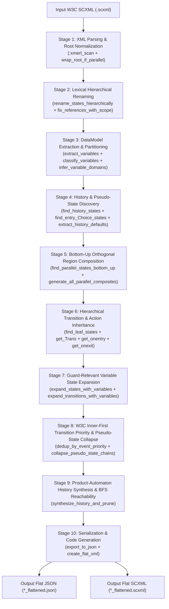

# 1.2 — Compiler Pipeline Architecture

⬅️ [[1.1 - System Overview & Motivation]] | 🏠 [[00 - Home & MOC|Home & MOC]] | ➡️ [[1.3 - Lexical Normalization & Scope Resolution]]

---

## 1. End-to-End 10-Stage Compilation Pipeline

The production compiler in [lib/scxml_flattener_full.exs](file:////wsl.localhost/Ubuntu-24.04/home/jvrmalv/code/statechart_flattener/lib/scxml_flattener_full.exs) (`SCXMLFlattenerFull.flatten_hierarchy/1`, lines 18–199) executes a deterministic **10-stage model-to-model compilation pipeline** over Erlang `:xmerl` XML records and Elixir maps/sets:



---

## 2. Detailed Stage Breakdown & Source Code Map

| Stage | Function(s) in [`lib/scxml_flattener_full.exs`](file:////wsl.localhost/Ubuntu-24.04/home/jvrmalv/code/statechart_flattener/lib/scxml_flattener_full.exs) | Line Range | Input Representation | Output Representation | Key Responsibility |
| :---: | :--- | :---: | :--- | :--- | :--- |
| **1** | `wrap_root_if_parallel/1`<br/>`extract_initial_state/1` | `L204–L249` | Raw `:xmerl` `<scxml>` element | Normalized `:xmerl` tree | Detects top-level sibling `<state>` regions with no `initial` attribute on `<scxml>` (e.g., `watch.scxml`) and wraps them in `<parallel id="_root">`. |
| **2** | `rename_states_hierarchically/1`<br/>`collect_rename_map/3`<br/>`apply_scoped_renaming/2`<br/>`resolve_with_scope/3` | `L255–L488` | Normalized `:xmerl` tree | Scoped `:xmerl` tree with globally unique IDs | Prefixes every `<state>`, `<parallel>`, and `<history>` ID with its full ancestor chain (`a_b_c`) and resolves `target` and `initial` attributes using LCA scope + unique suffix fallback. |
| **3** | `extract_variables/1`<br/>`classify_variables/2`<br/>`infer_variable_domains/3` | `L494–L678` | Scoped `:xmerl` tree | `guard_vars`, `display_vars`, `var_domains` | Parses `<datamodel><data>` declarations, partitions variables into **guard-relevant** vs. **display-only**, and infers finite domains $D_v$ for each mutable guard variable. |
| **4** | `find_history_states/1`<br/>`find_entry_Choice_states/1`<br/>`extract_history_defaults/3`<br/>`build_history_Marker_info/3` | `L684–L828` | Scoped `:xmerl` tree | `history_states`, `history_defaults`, `history_info` | Locates `<history>` tags and itemis CREATE `.entry_0` / `.choice_0` pseudo-states, replaces history targets with `_HISTORY_<id>_` markers, and records whether each history node is `:shallow` or `:deep`. |
| **5** | `find_parallel_states_bottom_up/1`<br/>`generate_all_parallel_composites/2` | `L834–L1068` | Scoped `:xmerl` tree + `history_defaults` | `parallel_composites` (`%{par_id => [comp_states]}`) | Traverses `<parallel>` elements bottom-up (innermost first), builds the Cartesian product of leaf states across regions, and synchronizes internal/external parallel transitions. |
| **6** | `find_leaf_states/2`<br/>`resolve_composite_initial_targets/3`<br/>`get_Trans/2`, `get_onentry/2`, `get_onexit/2` | `L1393–L1579` | Scoped `:xmerl` tree + `parallel_composites` | `flat_states` (before variable expansion) | Collects non-parallel atomic leaf states, merges them with `parallel_composites`, resolves composite state targets down to leaf initial chains, and inherits ancestor `onentry`/`onexit`/transitions. |
| **7** | `expand_states_with_variables/4`<br/>`expand_transitions_with_variables/5`<br/>`evaluate_condition/4` | `L1074–L1301` | `flat_states` + `guard_vars` + `var_domains` | `expanded_states` ($S_{\text{atomic}} \times D_{\text{vars}}$) | Takes the Cartesian product of atomic/composite control states with guard-relevant variable domains, statically evaluates `In(...)` and variable guards, and computes target variable valuations via `execute_actions/5` + `snap_to_domain/2`. |
| **8** | `dedup_by_event_priority/1`<br/>`collapse_pseudo_state_chains/3` | `L1320–L1391` | `expanded_states` | Priority-deduplicated & chain-collapsed `expanded_states` | Enforces W3C inner-first/document-order priority (`source_depth` + `doc_order`) and collapses transient `.entry_0` / `.choice_0` pseudo-state chains via $\varepsilon$-closure (`_auto`). |
| **9** | `synthesize_history_and_prune/5`<br/>`do_history_bfs/8`<br/>`update_hist_env_on_transition/6` | `L1581–L1755` | `expanded_states` + `history_info` + `initial_state` | `reachable_states` ($Q \subseteq S_{\text{atomic}} \times D_{\text{vars}} \times H_{\text{memory}}$) | Performs forward BFS over `(base_state_id, hist_env)` pairs, dynamically tracking exited configurations for every shallow/deep `<history>` node and resolving `_HISTORY_<id>_` markers on the fly. |
| **10** | `export_to_json/2`<br/>`create_flat_xml/3` | `L1757–L1810` | `reachable_states` + `final_initial` | JSON string & `:xmerl` SCXML string | Emits the pretty-printed JSON state dictionary (`*_flattened.json`) and flat W3C SCXML document (`*_flattened.scxml`). |

---

## 3. Core Internal Data Structures

### 3.1 State Representation (`flat_state` / `expanded_state`)
Throughout Stages 5–9, each state is represented as an Elixir map:

```elixir
%{
  id: "_root___root_modes_Regular_Clock_normal___root_chime_quiet___root_light_off__alarm_1_enabled_false__...",
  onentry: [
    {:log, [expr: "display_time()"]},
    {:assign, [location: "time_set", expr: "0"]}
  ],
  onexit: [],
  transitions: [
    %{
      event: "d_button",
      cond: nil,
      target: "_root___root_modes_Regular_Clock_wait_set___root_chime_quiet___root_light_off__...",
      actions: [{:script, [], ['time_set = 1']}],
      source_depth: 4,
      doc_order: 12
    }
  ]
}
```

### 3.2 Canonical State Identifier Encoding
Every generated state identifier in the final product automaton encodes up to **three orthogonal coordinates** separated by double underscores (`__`):

$$\underbrace{\text{Control Configuration } s \in S_{\text{atomic}}}_{\text{Hierarchical path or Parallel tuple}} \;\; \texttt{\_\_} \;\; \underbrace{\text{Variable Valuation } \vec{v} \in D_{\text{vars}}}_{\texttt{var1\_val1\_\_var2\_val2}} \;\; \underbrace{[\texttt{\_\_H\_} \text{History Valuation } \vec{h} \in H_{\text{memory}}]}_{\text{Omitted when } \vec{h} = \vec{h}_{\text{default}}}$$

1. **Simple Leaf Control State**:
   `modes_Manual_Off`
2. **Parallel Composite Control State**:
   `<parallel_id>__<region_1_leaf>__<region_2_leaf>__...`
   Example: `_root___root_modes_Regular_Clock_normal___root_chime_quiet___root_light_off`
3. **Variable Suffix**:
   Sorted alphabetically by variable name:
   `__alarm_1_enabled_false__alarm_1_time_0__alarm_2_enabled_false__alarm_2_time_0__chime_enabled_false__time_0__time_set_0`
4. **History Memory Suffix** (appended only when at least one history entry differs from its initial default):
   `__H_<short_hist_key>_<short_remembered_value>`

> [!TIP] Zero-Overhead Naming for Default History
> When a product state $(s, \vec{v}, \vec{h})$ has $\vec{h}$ equal to `history_defaults` (or when the statechart has no `<history>` elements at all), `encode_product_state_id/3` returns `base_state_id` unchanged. This guarantees backward-compatible state naming on history-free models while seamlessly disambiguating states that differ only in remembered history.

---

## 4. Pipeline Complexity & Pruning Efficiency

A critical design principle of [lib/scxml_flattener_full.exs](file:////wsl.localhost/Ubuntu-24.04/home/jvrmalv/code/statechart_flattener/lib/scxml_flattener_full.exs) is **staged pruning**:

1. **Variable Classification (Stage 3)** eliminates display-only variables before Cartesian expansion. In `watch.scxml`, this reduces the variable factor from $2^{14} = 16,384$ to $2^7 = 128$ (a **$128\times$ reduction**).
2. **Transition Priority Deduplication (Stage 8)** removes shadowed ancestor transitions before BFS exploration.
3. **On-the-Fly History Product BFS (Stage 9)** only materializes `(base_state_id, hist_env)` pairs that are **actually reachable** from `(initial_state, history_defaults)` via valid event sequences. In `watch.scxml`, instead of materializing all $8,192 \times (\text{theoretical history combinations}) > 10^6$ states, BFS discovers exactly **23,040 reachable configurations**.
