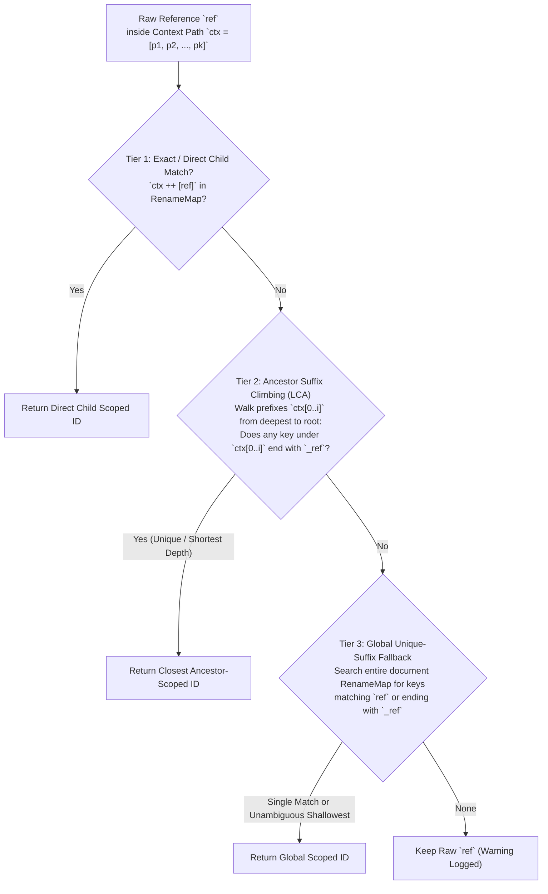

# 1.3 — Lexical Normalization & Scope Resolution

⬅️ [[1.2 - Compiler Pipeline Architecture]] | 🏠 [[00 - Home & MOC|Home & MOC]] | ➡️ [[1.4 - Orthogonal Regions & Parallel Composition]]

---

## 1. Why Lexical Normalization Is Required

In visual statechart editors such as **itemis CREATE (YAKINDU)**, sibling composite states frequently reuse identical substate names. For example:
- In [_04_LightAndMotionSensingLightSwitch.scxml](file:////wsl.localhost/Ubuntu-24.04/home/jvrmalv/code/statechart_flattener/lib/original_scxml/_04_LightAndMotionSensingLightSwitch.scxml), `Manual`, `Automatic`, `Motion_Sensing`, and `Light_Sensing` all contain substates or entry pseudo-states with overlapping local names (`Off`, `On`, `entry_0`).
- In [harel_watch/watch.scxml](file:////wsl.localhost/Ubuntu-24.04/home/jvrmalv/code/statechart_flattener/harel_watch/watch.scxml) and [harel_watch/watch_subdiagrams.scxml](file:////wsl.localhost/Ubuntu-24.04/home/jvrmalv/code/statechart_flattener/harel_watch/watch_subdiagrams.scxml):
  - Both `Alarm_1` and `Alarm_2` contain children named `disabled`, `enabled`, `set`, `hours`, `minutes`, and `ten_minutes`.
  - Both `chime_status` and `Alarm_1`/`Alarm_2` contain `disabled` and `enabled`.
  - Both `light` and `power` (in `TrafficLightCtrl.scxml`) use `off` and `on`.

If hierarchy is stripped without full path qualification, these states collide in the flat state namespace.

---

## 2. Anonymous Root Parallel Wrapping (`wrap_root_if_parallel/1`)

According to the W3C SCXML specification, an `<scxml>` root element usually designates a single `initial` state or contains a single top-level `<state>` or `<parallel>`. However, itemis CREATE exports top-level orthogonal regions (such as `modes`, `chime`, and `light` in `watch.scxml`) as **multiple top-level `<state>` siblings directly under `<scxml>` without an `initial` attribute on `<scxml>`**:

```xml
<scxml xmlns="http://www.w3.org/2005/07/scxml" version="1.0" datamodel="ecmascript">
  <datamodel>...</datamodel>
  <state id="modes" initial="Regular">...</state>
  <state id="chime" initial="quiet">...</state>
  <state id="light" initial="off">...</state>
</scxml>
```

> [!NOTE] Automatic `_root` Synthesis
> `wrap_root_if_parallel/1` ([lib/scxml_flattener_full.exs](file:////wsl.localhost/Ubuntu-24.04/home/jvrmalv/code/statechart_flattener/lib/scxml_flattener_full.exs#L204-L234)) inspects the root `<scxml>` element in Stage 1:
> - If `<scxml>` has **no `initial` attribute** and **$\ge 2$ direct `<state>` children**, it wraps all top-level `<state>` children inside a synthetic `<parallel id="_root">` element and sets `initial="_root"` on `<scxml>`.
> - This unifies top-level concurrency with standard `<parallel>` processing in Stage 5.

---

## 3. Hierarchical Path Qualification (`rename_states_hierarchically/1`)

Every `<state>`, `<parallel>`, and `<history>` element in the XML tree is recursively renamed by joining its ancestor IDs with underscores (`_`):

$$\text{NewID}(n) = \begin{cases} \text{ID}(n) & \text{if } \text{Parent}(n) = \texttt{<scxml>} \\ \text{NewID}(\text{Parent}(n)) \mathbin{\Vert} \texttt{"\_"} \mathbin{\Vert} \text{ID}(n) & \text{otherwise} \end{cases}$$

For example, in `watch.scxml`, the `normal` state inside `Clock` inside `Regular` inside `modes` under `_root` is renamed:

$$\texttt{normal} \longrightarrow \texttt{\_root\_modes\_Regular\_Clock\_normal}$$

---

## 4. Three-Tier Target & Initial Scope Resolution (`resolve_with_scope/3`)

Once state `id` attributes are renamed, every `<transition target="...">` and `<state initial="...">` reference in the document must be updated to point to the corresponding renamed ID. Because SCXML references can be local, relative to an ancestor, or cross-tree (in subdiagram exports), `resolve_with_scope/3` ([lib/scxml_flattener_full.exs](file:////wsl.localhost/Ubuntu-24.04/home/jvrmalv/code/statechart_flattener/lib/scxml_flattener_full.exs#L422-L488)) implements a **three-tier resolution cascade**:



### Why Tier 3 (Global Suffix Fallback) Was Critical for `watch_subdiagrams.scxml`
In `watch_subdiagrams.scxml`, itemis CREATE exports subdiagrams where transitions inside `Regular` reference targets like `wait_set` or `Stop_Watch.entry_0` without qualifying intermediate containers (`Clock` or `Stop_Watch`), or cross-hierarchy targets in sibling branches.
- **Tier 1** checks if `wait_set` is a direct child of the transition's source state.
- **Tier 2** walks up the lexical scope stack (`[...Regular, Clock]`, `[...Regular]`, `[...modes]`, `[_root]`), picking the closest matching descendant in the same subtree.
- **Tier 3** acts as a global fallback if the reference crosses top-level boundaries, selecting the unique (or shallowest) state whose hierarchical path ends with `_{ref}`.

---

## 5. Handling Composite Initial Chains (`resolve_composite_initial_targets/3`)

Even after lexical scope resolution, a transition in SCXML may target a **composite state** rather than an atomic leaf state (for example, `target="_root_modes_Alarm_1"` or `target="_root_modes_Regular"`).

In a flat FSM, composite states do not exist as runtime states—only atomic leaf states (and parallel composite tuples) exist. Therefore, `resolve_composite_initial_targets/3` ([lib/scxml_flattener_full.exs](file:////wsl.localhost/Ubuntu-24.04/home/jvrmalv/code/statechart_flattener/lib/scxml_flattener_full.exs#L1408-L1479)) recursively drills down every composite target's `initial` attribute chain:

$$\text{ResolveLeaf}(s) = \begin{cases} s & \text{if } s \in S_{\text{leaf}} \cup S_{\text{history}} \cup S_{\text{choice}} \\ \text{InitialParallelTuple}(s) & \text{if } s \in S_{\text{parallel}} \\ \text{ResolveLeaf}(\text{initial}(s)) & \text{if } s \in S_{\text{composite}} \end{cases}$$

Furthermore, as the compiler drills down from composite state $C_1 \to C_2 \to \dots \to s_{\text{leaf}}$, it **accumulates the `onentry` actions** of every intermediate composite state $C_i$ entered along the path, ensuring W3C-compliant entry action execution order (outermost ancestor first, down to the leaf).
