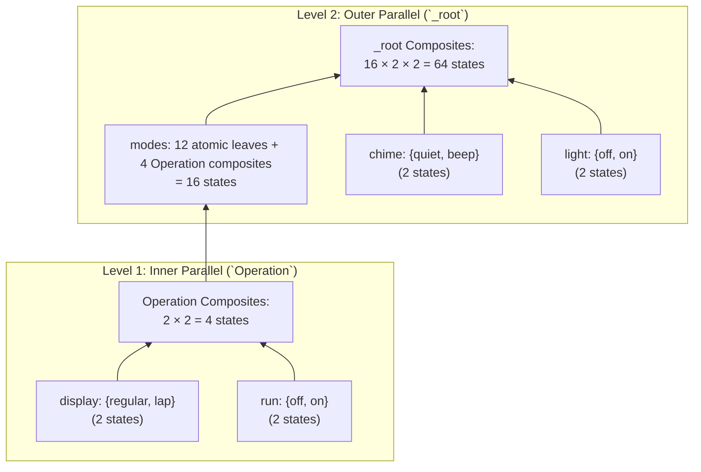

# 1.4 — Orthogonal Regions & Parallel Composition

⬅️ [[1.3 - Lexical Normalization & Scope Resolution]] | 🏠 [[00 - Home & MOC|Home & MOC]] | ➡️ [[1.5 - DataModel & Combinatorial Explosion Mitigation]]

---

## 1. Semantics of SCXML `<parallel>` (AND-States)

In a Harel Statechart, a `<parallel id="P">` state contains $m \ge 2$ child `<state id="R_i">` elements called **orthogonal regions**. When the statechart enters $P$, **all $m$ regions are entered simultaneously**, so the active control configuration of $P$ is an $m$-tuple in the Cartesian product of the leaf states of each region:

$$S_P = \prod_{i=1}^{m} \text{Leaves}(R_i) = \text{Leaves}(R_1) \times \text{Leaves}(R_2) \times \dots \times \text{Leaves}(R_m)$$

Each composite configuration $\vec{r} = (r_1, r_2, \dots, r_m) \in S_P$ is encoded by the compiler using a double-underscore separator:

$$\text{ID}(\vec{r}) = P \mathbin{\Vert} \texttt{"\_\_"} \mathbin{\Vert} r_1 \mathbin{\Vert} \texttt{"\_\_"} \mathbin{\Vert} r_2 \mathbin{\Vert} \dots \mathbin{\Vert} \texttt{"\_\_"} \mathbin{\Vert} r_m$$

---

## 2. Multi-Level Bottom-Up Parallel Flattening

A major challenge encountered in [harel_watch/watch.scxml](file:////wsl.localhost/Ubuntu-24.04/home/jvrmalv/code/statechart_flattener/harel_watch/watch.scxml) is **nested `<parallel>` states**:
- The outer parallel state `_root` has 3 orthogonal regions:
  1. `_root_modes` (29 leaf states + 1 nested parallel state)
  2. `_root_chime` (2 leaf states: `quiet`, `beep`)
  3. `_root_light` (2 leaf states: `off`, `on`)
- Inside `_root_modes_Regular_Stop_Watch`, there is a **nested `<parallel id="_root_modes_Regular_Stop_Watch_Operation">`** with 2 orthogonal regions:
  1. `display` (2 leaf states: `regular`, `lap`)
  2. `run` (2 leaf states: `off`, `on`)

### Bottom-Up Ordering (`find_parallel_states_bottom_up/1`)
If `_root` were flattened before `Operation`, `_root_modes` would not yet know the 4 composite leaf states of `Operation`. Therefore, `find_parallel_states_bottom_up/1` ([lib/scxml_flattener_full.exs](file:////wsl.localhost/Ubuntu-24.04/home/jvrmalv/code/statechart_flattener/lib/scxml_flattener_full.exs#L834-L855)) performs a post-order traversal of `<parallel>` nodes, sorting them **deepest-first**:



1. **Step 1 (Inner Parallel)**: `Operation` is expanded into $2 \times 2 = 4$ composite states:
   - `...Operation__...display_regular__...run_off`
   - `...Operation__...display_regular__...run_on`
   - `...Operation__...display_lap__...run_off`
   - `...Operation__...display_lap__...run_on`
2. **Step 2 (Outer Parallel)**: When `find_region_leaves/3` collects the leaves of `_root_modes`, it substitutes the 4 `Operation` composite states in place of the `Operation` subtree, yielding $12 + 4 = 16$ leaves for `modes`. Multiplying by `chime` ($2$) and `light` ($2$) produces $16 \times 2 \times 2 = \mathbf{64}$ flat control states for `watch.scxml`.

---

## 3. Synchronized vs. Independent Transitions in Orthogonal Regions

When an input event $e \in \Sigma$ occurs while a parallel state $P$ is in configuration $\vec{r} = (r_1, \dots, r_m)$, there are three distinct transition cases handled by `build_parallel_transitions/5` ([lib/scxml_flattener_full.exs](file:////wsl.localhost/Ubuntu-24.04/home/jvrmalv/code/statechart_flattener/lib/scxml_flattener_full.exs#L940-L1068)):

### Case A: Intra-Region Independent Transition
Only region $i$ has an enabled transition $r_i \xrightarrow{e} r'_i$, while all other regions $j \neq i$ do not respond to $e$.
- **Result**: The parallel configuration transitions to $(r_1, \dots, r'_i, \dots, r_m)$, executing `onexit(r_i) ++ actions ++ onentry(r'_i)`.
- **Example (`watch.scxml`)**: Pressing `b_button` turns the light on (`_root_light_off` $\to$ `_root_light_on`) regardless of whether `modes` is in `Clock`, `Alarm_1`, or `Stop_Watch`.

### Case B: Multi-Region Synchronized Transition (Simultaneous Event Consumption)
Multiple regions $i_1, i_2, \dots, i_k$ simultaneously have enabled transitions on the same event $e$.
- **Result**: In Harel Statecharts and W3C SCXML, external events are broadcast to all orthogonal regions simultaneously. The compiler groups transitions by `event` across all active region leaves and computes the joint transition:
  $$(r_1, \dots, r_m) \xrightarrow{e} (r'_1, \dots, r'_m)$$
  where $r'_i$ is updated in every region that responds to $e$, and all responding regions' actions, `onexit`, and `onentry` blocks are concatenated.

### Case C: Parallel-Exiting & Ancestor Transitions
A transition originates on the `<parallel>` element itself (or an ancestor of `<parallel>`), or a region transition targets a state **outside** the `<parallel>` container.
- **Example (`_05_PresenceSimulationLightSwitch.scxml`)**: While in `<parallel id="Active">` (regions `schedule` and `presence`), the event `change_mode` transitions to `Manual_Off` outside `Active`.
- **Example (`watch.scxml`)**: While in `Operation` (parallel regions `display` and `run`), pressing `a_button` exits `Operation` (and `Stop_Watch` and `Regular`) to `Update_Watch`.
- **Result**: All active regions $r_1, \dots, r_m$ execute their `onexit` handlers, the `<parallel>` container executes its `onexit`, and control transfers to the external target (or updates the outer parallel tuple's `modes` slot while preserving the outer `chime` and `light` slots!).

> [!IMPORTANT] Partial Tuple Replacement for Nested Parallels
> When an inner parallel state (`Operation`) exits to a sibling state inside the same outer region (`_root_modes`), the outer parallel regions (`_root_chime` and `_root_light`) **must not reset** to their initial defaults! The compiler replaces only the `_root_modes` component of the `_root` tuple while keeping `_root_chime` and `_root_light` intact.

---

## 4. Cross-Region State Predicates: `In('StateName')`

SCXML guards frequently query whether another orthogonal region (or ancestor state) is currently active using the `In('StateName')` predicate:
- In [statechart_with_integrations/TrafficLightCtrl.scxml](file:////wsl.localhost/Ubuntu-24.04/home/jvrmalv/code/statechart_flattener/statechart_with_integrations/TrafficLightCtrl.scxml):
  `cond="In('Green')"` and `cond="In('Red')"` inside the `timer` region check which light is currently active in the sibling `trafficlight` region.
- In [harel_watch/watch.scxml](file:////wsl.localhost/Ubuntu-24.04/home/jvrmalv/code/statechart_flattener/harel_watch/watch.scxml):
  `cond="In('on')"` and `cond="In('zero')"` check sibling sub-states.

### Static Compile-Time Resolution of `In(...)`
Because every state in our flattened machine explicitly encodes the active leaf of **every** orthogonal region in its state ID, `In('X')` is **100% statically decidable at compile time**!

`evaluate_in_predicates/2` ([lib/scxml_flattener_full.exs](file:////wsl.localhost/Ubuntu-24.04/home/jvrmalv/code/statechart_flattener/lib/scxml_flattener_full.exs#L1184-L1209)) replaces every `In('X')` (or `In("X")`) call in a guard expression with `"true"` or `"false"` before variable evaluation:

```elixir
defp state_matches_in?(composite_state_id, queried_name) do
  # Strip variable suffix (`__var_val`) and split parallel components
  control_part = composite_state_id |> String.split("__") |> filter_control_parts()
  Enum.any?(control_part, fn comp ->
    comp == queried_name or
      String.ends_with?(comp, "_" <> queried_name) or
      String.contains?(comp, "_" <> queried_name <> "_")
  end)
end
```

- If `comp` is `_root_main_trafficlight_normal_Green`, then:
  - `In('Green')` $\to$ `true` (ends with `_Green`)
  - `In('normal')` $\to$ `true` (contains `_normal_`)
  - `In('Red')` $\to$ `false`

> [!WARNING] Crucial Fix in Commit `2e88cae`: `In(...)` in Non-Parallel States
> Initially, `In(...)` predicates were only evaluated inside `build_parallel_transitions`. However, in `watch.scxml`, several transitions defined on regular states (which later become components of the `_root` parallel tuple) also use `In(...)` guards. Moving `evaluate_in_predicates/2` into `evaluate_condition/4` during Stage 7 ensured that **all** transitions—whether originating on regular states or parallel states—resolve `In(...)` against the full composite state ID.
