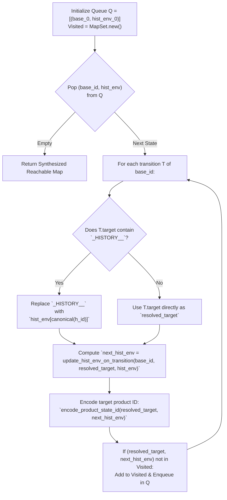

# 1.6 — Generalized History Synthesis (Product Automaton)

⬅️ [[1.5 - DataModel & Combinatorial Explosion Mitigation]] | 🏠 [[00 - Home & MOC|Home & MOC]] | ➡️ [[1.7 - Transition Priority, Shadowing & Determinism]]

---

## 1. Why Static History Substitution Is Semantically Insufficient

In W3C SCXML and Harel Statecharts, a `<history id="H" type="shallow|deep">` pseudo-state inside a composite state $P$ records the active configuration of $P$ immediately before $P$ is exited:
- **Shallow History (`type="shallow"`)**: Remembers which **direct child** $C_i$ of $P$ was active when $P$ was exited. Upon re-entering $H$, the machine enters $C_i$ (and follows $C_i$'s default initial chain down to a leaf).
- **Deep History (`type="deep"`)**: Remembers the exact **atomic leaf state** (or nested parallel tuple) inside $P$ that was active when $P$ was exited, regardless of nesting depth.

### Failure of Early Static Substitution (Commits `4d1e9ee` – `2e88cae`)
Up through commit `2e88cae`, the compiler extracted the `<transition target="default_target">` inside `<history id="H">`, stored `history_defaults[H] = default_target`, and statically replaced every `_HISTORY_H_` marker with `default_target`.

While that eliminated `<history>` tags syntactically, it meant **re-entering a history state ALWAYS jumped to the initial default**, completely forgetting runtime history!
- For example, in `watch.scxml`, if the user navigated inside `Regular` from `Clock_normal` $\to$ `Alarm_1` $\to$ `Alarm_2` $\to$ `Chime` $\to$ `Stop_Watch`, started the stopwatch (`Operation__display_regular__run_on`), exited `Regular` via `a_button` to `Update_Watch`, and then returned to `Regular` via `b_button` (targeting `deep_entry`), the static flattener reset the watch back to `Clock_normal` instead of resuming `Stop_Watch`!

---

## 2. Formal Product-Automaton Formulation

To make a flat FSM genuinely remember past configurations without a runtime memory stack, **history memory must become an explicit coordinate of the flat state space**:

$$Q_{\text{reachable}} \subseteq S_{\text{atomic}} \times D_{\text{vars}} \times H_{\text{memory}}$$

where:
- $S_{\text{atomic}}$ is the set of flat control configurations (atomic leaves and parallel tuples),
- $D_{\text{vars}} = \prod_{v \in V_{\text{guard}}} D_v$ is the Cartesian product of guard-relevant variable domains, and
- $H_{\text{memory}} = \prod_{h \in \mathcal{H}} \text{Range}(h)$ is the valuation of all history registers $h \in \mathcal{H}$ in the statechart.

Each state in the flattened automaton is a pair `(base_state_id, hist_env)`, where:
- `base_state_id` encodes $(s, \vec{v}) \in S_{\text{atomic}} \times D_{\text{vars}}$, and
- `hist_env` is a map `%{hist_id => remembered_leaf_or_tuple}` representing $\vec{h} \in H_{\text{memory}}$.

---

## 3. Unified Representation of SCXML `<history>` and itemis `.entry_0`

Statecharts exported from itemis CREATE use two syntactic patterns for history:
1. Explicit W3C `<history type="shallow|deep" id="...">` elements (e.g., `deep_entry`, `time_set` in `watch.scxml`; `hist` in `TrafficLightCtrl.scxml`).
2. Composite states targeted directly or via `.entry_0` pseudo-states that contain an internal `<history>` child (e.g., `Stop_Watch.entry_0` in `watch.scxml`; `Automatic.entry_0`, `Light_Sensing.entry_0`, `Motion_Sensing.entry_0` in `_04`).

In Stage 4, `build_history_marker_info/3` ([lib/scxml_flattener_full.exs](file:////wsl.localhost/Ubuntu-24.04/home/jvrmalv/code/statechart_flattener/lib/scxml_flattener_full.exs#L780-L828)) builds a unified registry `history_info` mapping every history marker ID `h_id` to:

```elixir
%{
  parent_scope: "_root_modes_Regular",          # The composite state P whose exit triggers recording
  type: :deep | :shallow,                       # History granularity
  default_leaf: "_root_modes_Regular_Clock_normal", # Initial fallback before P is ever visited
  child_defaults: %{                            # For :shallow history: maps each direct child C_i of P
    "_root_modes_Regular_Clock" => "_root_modes_Regular_Clock_normal",
    "_root_modes_Regular_Stop_Watch" => "_root_modes_Regular_Stop_Watch_Zero",
    ...                                         # to C_i's default initial leaf
  }
}
```

> [!NOTE] Canonical Aliasing of Sibling History Markers
> If multiple markers refer to the same `(parent_scope, type)` (for example, both `_root_modes_Regular` and `_root_modes_Regular_deep_entry` track deep history of `Regular`), `canonical_history_key/2` aliases them to a single canonical register in `hist_env` to avoid redundant state duplication.

---

## 4. On-the-Fly BFS Synthesis Algorithm (`synthesize_history_and_prune/5`)

Instead of pre-multiplying $8,192 \times \prod |\text{Range}(h)|$ (which would generate hundreds of thousands of unreachable history combinations), Stage 9 (`synthesize_history_and_prune/5`, lines 1581–1755) executes a **forward Breadth-First Search (BFS)** starting from the initial product state:

$$q_0 = (\texttt{initial\_base\_state}, \;\; \texttt{hist\_env}_0)$$

where $\texttt{hist\_env}_0$ initializes every canonical history register to its `default_leaf` (or initializes registers whose scope is already active in $q_0$ to their active leaf in $q_0$).



### How `update_hist_env_on_transition/6` Updates History Memory
On every transition from `source_base_id` to `resolved_target_base_id`, for each canonical history register $h$ with parent composite scope $P$:
1. Extract the active leaf (or nested parallel composite) inside scope $P$ from `source_base_id`.
2. **If `source_base_id` was inside $P$** (i.e., an active component starts with $P \mathbin{\Vert} \texttt{"\_"}$):
   - **If `type == :deep`**: Record the exact active leaf (or nested parallel tuple, e.g., `_root_modes_Regular_Stop_Watch_Operation__...display_lap__...run_on`) in `next_hist_env[h]`.
   - **If `type == :shallow`**: Identify which direct child $C_i$ of $P$ contains the active leaf, and record $C_i$'s default initial leaf (`child_defaults[C_i]`) in `next_hist_env[h]`.
3. Additionally, if `resolved_target_base_id` enters or stays in $P$, update $h$ to reflect the newly active configuration in $P$ so subsequent transitions always have the latest state of $P$.

---

## 5. Substring Collision Bug in `_HISTORY_` Replacement & Its Fix

During Session 3 (March 2026) and Session 8 (September 2026), a subtle bug was discovered when replacing `_HISTORY_<h_id>_` markers in transition targets:
- Suppose `history_states` contains both:
  - `h_1 = "modes_Automatic"`
  - `h_2 = "modes_Automatic_Automatic.entry_0"`
- If `Enum.reduce` replaces `_HISTORY_modes_Automatic_` **before** `_HISTORY_modes_Automatic_Automatic.entry_0_`, then the prefix of `_HISTORY_modes_Automatic_Automatic.entry_0_` matches `_HISTORY_modes_Automatic_`, corrupting the string into:
  `modes_Automatic_Motion_Sensing_StillAutomatic.entry_0_`!

> [!IMPORTANT] Longest-Key-First Sorting Rule
> Whenever `_HISTORY_<id>_` markers are substituted, keys **must be sorted by descending string length** (`Enum.sort_by(&String.length/1, :desc)`) or matched with exact delimiter boundaries before replacement. This guarantees that longer, more specific history markers (`modes_Automatic_Automatic.entry_0`) are always replaced before shorter prefix markers (`modes_Automatic`).

---

## 6. Quantitative Impact of Generalized History on `watch.scxml`

In `watch.scxml`, there are **3 history mechanisms** inside `_root_modes`:
1. `Regular` **shallow history** (`time_set`): Remembers which top-level child of `Regular` was active (`Clock` vs. `Stop_Watch`) when entering/returning from `wait_set` / `Update_Watch`.
2. `Regular` **deep history** (`deep_entry`): Remembers the exact leaf (or `Stop_Watch` substate) inside `Regular`.
3. `Stop_Watch` **deep history** (`Stop_Watch.entry_0`): Remembers which of the 5 `Stop_Watch` leaves (`Zero` or one of the 4 `Operation` parallel states) was active when cycling through `Alarm_1` $\to$ `Alarm_2` $\to$ `Chime` $\to$ `Stop_Watch`.

When `synthesize_history_and_prune/5` explores `watch.scxml`:
- Out of $8,192$ base states, **3,072 base states** are reachable from the initial configuration.
- Across those 3,072 reachable base states, the valid combinations of remembered `Regular` history and `Stop_Watch` deep history expand the state space by an average factor of **$7.5\times$** ($3,072 \times 7.5 = \mathbf{23,040}$ reachable product states and **232,704 transitions**).
- Every single one of those 23,040 states is reachable, deterministic, and passes all 3 history trace verification suites in [harel_watch/verify_history.py](file:////wsl.localhost/Ubuntu-24.04/home/jvrmalv/code/statechart_flattener/harel_watch/verify_history.py).
