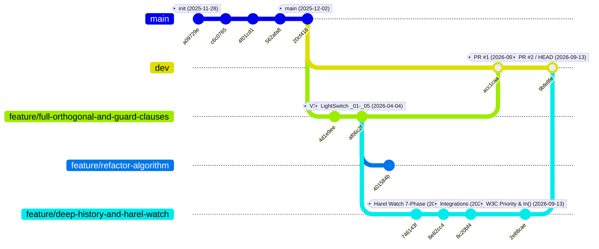

# 2.1 — Git Commit & Branch History

⬅️ [[1.8 - Evolution of Flattener Engines (V1 to V3 & Shin)]] | 🏠 [[00 - Home & MOC|Home & MOC]] | ➡️ [[2.2 - Research & Debugging Sessions Log]]

---

## 1. Repository Branch Topology

The Git repository (`https://github.com/jvrmalv/statechart_flattener.git`) spans **14 commits** across 5 local/remote branches, plus the **September 18, 2026 working-tree overhaul** (generalized product-automaton history synthesis and formal Python verification suites):

---

## 2. Complete Chronological Commit Audit

| # | Commit Hash | Date | Author | Branch(es) | Commit Message & Technical Summary |
| :---: | :---: | :---: | :--- | :--- | :--- |
| **1** | `a09729e` | `2025-11-28` | `jvrmalv` | `main` | **`init: initial commit`** Initialized Elixir Mix project (`mix.exs`), `lib/state.ex`, `lib/statechart_flattener.ex`, `lib/run_parser.exs`, and the V1 basic hierarchy flattener [lib/flatten_scxml.exs](file:////wsl.localhost/Ubuntu-24.04/home/jvrmalv/code/statechart_flattener/lib/flatten_scxml.exs) (179 LOC) along with `lib/hierarchical_machine.scxml` and `lib/test.scxml`. |
| **2** | `c6c0765` | `2025-12-02` | `Felipe Cannarozzo` | `main` | **`Add bat install`** Added Windows batch setup helper `install.bat` for local Erlang/Elixir environment setup. |
| **3** | `4f01cd1` | `2025-12-02` | `Felipe Cannarozzo` | `main` | **`Adding scxml`** Added sample SCXML test cases (`jtest2.scxml`). |
| **4** | `562afa8` | `2025-12-02` | `Felipe Cannarozzo` | `main` | **`Add jtest2 flat. Json and scxml`** Added flattened JSON and SCXML outputs for `jtest2` using the V1 flattener. |
| **5** | `20cf416` | `2025-12-02` | `Felipe Cannarozzo` | `main`, `origin/main` | **`add the first test`** Added initial test artifacts on `main` (current tip of `main`). |
| **6** | `4d1e9ee` | `2025-12-30` | `jvrmalv` | `feature/full-orthogonal-and-guard-clauses` | **`feat: full orthogonal, conditional and history states flatenner with examples`** Major milestone introducing [lib/scxml_flattener_full.exs](file:////wsl.localhost/Ubuntu-24.04/home/jvrmalv/code/statechart_flattener/lib/scxml_flattener_full.exs) (1,130 LOC): hierarchical state renaming, variable expansion, shallow history, single-level `<parallel>` states, pseudo-state chain collapsing, and BFS reachability pruning. Added `guards_example.scxml`, `shallow_history_test.scxml`, `parallel_states_with_shallow_history.scxml`, `test_elevator.scxml`, `test_traffic_light.scxml`, `test_vending_machine.scxml`. |
| **7** | `af06c2f` | `2026-04-04` | `jvrmalv` | `feature/full-orthogonal-and-guard-clauses` | **`chore: subindo arquivos utilizados para teste manual do algoritmo`** Committed 51 files including the canonical progressive LightSwitch suite (`lib/original_scxml/_01`..`_05`), all generated JSONs (`lib/generated_jsons/`), [lib/generated_jsons/count_stats.py](file:////wsl.localhost/Ubuntu-24.04/home/jvrmalv/code/statechart_flattener/lib/generated_jsons/count_stats.py), [lib/best_to_date_backup.exs](file:////wsl.localhost/Ubuntu-24.04/home/jvrmalv/code/statechart_flattener/lib/best_to_date_backup.exs), and the Q-learning fixes (`get_hour()`/`get_rand()` `:error` fallback, `"_auto"` event naming, longest-first `_HISTORY_` sorting). |
| **8** | `401584b` | `2026-04-04` | `jvrmalv` | `feature/refactor-algorithm` | **`refatctor: mudança da estrutura, fix de alguns bugs`** Experimental branch refactoring internal helper structure in `scxml_flattener_full.exs`. |
| **9** | `746143f` | `2026-04-04` | `jvrmalv` | `feature/deep-history-and-harel-watch` | **`feat: support Harel Citizen Quartz Multi-Alarm III statechart flattening`** 7-phase enhancement to `lib/scxml_flattener_full.exs` (+472/-133 lines) enabling compilation of [harel_watch/watch.scxml](file:////wsl.localhost/Ubuntu-24.04/home/jvrmalv/code/statechart_flattener/harel_watch/watch.scxml) and [harel_watch/watch_subdiagrams.scxml](file:////wsl.localhost/Ubuntu-24.04/home/jvrmalv/code/statechart_flattener/harel_watch/watch_subdiagrams.scxml): guard vs. display variable partitioning (`classify_variables/2`), `In(...)` predicate evaluation, anonymous `_root` parallel wrapping, global suffix target fallback, bottom-up nested `<parallel>` composition, and nearest-value domain snapping (`snap_to_domain/2`). |
| **10** | `8e82cc4` | `2026-04-04` | `jvrmalv` | `feature/deep-history-and-harel-watch` | **`chore: add flattened outputs for Harel watch statecharts`** Committed the 7,040-state / 69,248-transition flattened JSON and SCXML artifacts for `watch.scxml` and `watch_subdiagrams.scxml` (+652,190 lines). |
| **11** | `8c20bf4` | `2026-04-20` | `jvrmalv` | `feature/deep-history-and-harel-watch` | **`chore: add backup for failed integration flattenings.`** Added external integration benchmarks [statechart_with_integrations/Elevator.scxml](file:////wsl.localhost/Ubuntu-24.04/home/jvrmalv/code/statechart_flattener/statechart_with_integrations/Elevator.scxml) and [statechart_with_integrations/TrafficLightCtrl.scxml](file:////wsl.localhost/Ubuntu-24.04/home/jvrmalv/code/statechart_flattener/statechart_with_integrations/TrafficLightCtrl.scxml) and their initial flattened outputs to diagnose runtime `_event.data` and `In('Green')` issues. |
| **12** | `acc1caa` | `2026-09-13` | `jvrmalv` | `dev` | **`Merge pull request #1 from jvrmalv/feature/full-orthogonal-and-guard-clauses`** Merged V2 LightSwitch flattener and test suites into `dev`. |
| **13** | `2e88cae` | `2026-09-13` | `jvrmalv` | `feature/deep-history-and-harel-watch` | **`feat: change condition resolving`** Eliminated synthetic non-determinism across `watch.scxml` (4,480 ND states $\to$ 0 ND states; 7,040 $\to$ 3,072 states), `TrafficLightCtrl.scxml`, and `Elevator.scxml` via W3C inner-first + document-order priority (`dedup_by_event_priority/1`), `In(...)` evaluation in regular states, and `"event [cond]"` disambiguation for runtime `:error` guards. |
| **14** | `9bfe8fe` | `2026-09-13` | `jvrmalv` | `dev` (`HEAD`) | **`Merge pull request #2 from jvrmalv/feature/deep-history-and-harel-watch`** Merged Harel Watch and condition-resolving enhancements into `dev`. |

---

## 3. Uncommitted Working Tree State (September 18, 2026 Milestone)

On top of `HEAD` (`9bfe8fe` on `dev`), the current working tree contains the **Phase 8 Generalized History & Verification Overhaul**:

| Modified / Untracked File | Status | Delta / Size | Description of Working-Tree Changes |
| :--- | :---: | :---: | :--- |
| [lib/scxml_flattener_full.exs](file:////wsl.localhost/Ubuntu-24.04/home/jvrmalv/code/statechart_flattener/lib/scxml_flattener_full.exs) | Modified | `+412 / -117 lines` (Now 1,715 LOC) | Generalized shallow & deep history product-automaton synthesis (`synthesize_history_and_prune/5`, `build_history_marker_info/3`, `update_hist_env_on_transition/6`), alarm beep transition target variable alignment, and nested parallel component replacement on history return. |
| [harel_watch/watch_flattened.json](file:////wsl.localhost/Ubuntu-24.04/home/jvrmalv/code/statechart_flattener/harel_watch/watch_flattened.json) | Modified | `84.18 MB` (23,040 states, 232,704 trans) | Updated from 3,072-state static-history output to the 23,040-state product-automaton output passing 100% of structural, behavioral, and history verification checks. |
| [harel_watch/watch_flattened.scxml](file:////wsl.localhost/Ubuntu-24.04/home/jvrmalv/code/statechart_flattener/harel_watch/watch_flattened.scxml) | Modified | `7.02 MB` (23,040 `<state>` elements) | Synchronized flat SCXML representation of the 23,040-state Citizen Quartz watch automaton. |
| [harel_watch/verify_flattened.py](file:////wsl.localhost/Ubuntu-24.04/home/jvrmalv/code/statechart_flattener/harel_watch/verify_flattened.py) | Untracked | `810 LOC` | Comprehensive 5-part automated verification suite (structural integrity, impossible states, domain coverage, behavioral trace checks, and BFS reachability/deadlocks). |
| [harel_watch/verify_history.py](file:////wsl.localhost/Ubuntu-24.04/home/jvrmalv/code/statechart_flattener/harel_watch/verify_history.py) | Untracked | `380 LOC` | Dedicated 3-suite automated history trace verifier testing shallow history in `Regular`, deep history in `Regular`, and deep history in `Stop_Watch` across parallel `Operation` states. |
| [lib/scxml_flattener_optimized.exs](file:////wsl.localhost/Ubuntu-24.04/home/jvrmalv/code/statechart_flattener/lib/scxml_flattener_optimized.exs) | Untracked | `505 LOC` | Preserved V2-Opt compact variable flattener prototype. |
| [lib/shin_script.exs](file:////wsl.localhost/Ubuntu-24.04/home/jvrmalv/code/statechart_flattener/lib/shin_script.exs) | Untracked | `283 LOC` | Preserved minimal orthogonal/history prototype script. |
