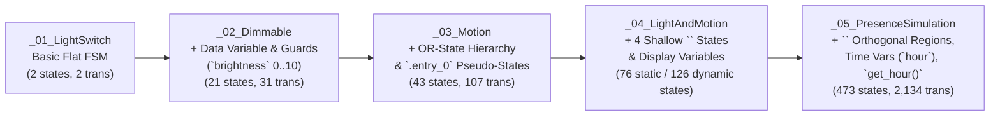

# 3.2 — Progressive LightSwitch Benchmark (`_01` to `_05`)

⬅️ [[3.1 - Master Metrics Dashboard]] | 🏠 [[00 - Home & MOC|Home & MOC]] | ➡️ [[3.3 - Harel Citizen Quartz Multi-Alarm III Watch Case Study]]

---

## 1. Benchmark Design: Incremental Statechart Feature Introduction

The **LightSwitch Benchmark Suite** in [lib/original_scxml/](file:////wsl.localhost/Ubuntu-24.04/home/jvrmalv/code/statechart_flattener/lib/original_scxml) (adapted from itemis CREATE / YAKINDU statechart tutorials) was designed as a **controlled 5-stage ablation benchmark**. Each model `_01` through `_05` adds exactly one major Harel Statechart formalism on top of the previous model:

---

## 2. Model-by-Model Technical & Quantitative Analysis

### 2.1 `_01_LightSwitch.scxml` — Baseline Flat FSM
- **Source**: [lib/original_scxml/_01_LightSwitch.scxml](file:////wsl.localhost/Ubuntu-24.04/home/jvrmalv/code/statechart_flattener/lib/original_scxml/_01_LightSwitch.scxml) (17 lines)
- **Output**: [lib/generated_jsons/_01_LightSwitch_flattened.json](file:////wsl.localhost/Ubuntu-24.04/home/jvrmalv/code/statechart_flattener/lib/generated_jsons/_01_LightSwitch_flattened.json)
- **Features Tested**: Single composite wrapper `main` containing `Off` and `On` toggled by `switch`, with `onentry` actions `turn_light_off()` and `turn_light_on()`.
- **Metrics**:
  - Atomic leaves: `2` (`main_Off__`, `main_On__`)
  - Reachable states: **2**
  - Transitions: **2** (1.00 avg out-degree)

---

### 2.2 `_02_DimmableLightSwitch.scxml` — Extended Data Variables & Guards
- **Source**: [lib/original_scxml/_02_DimmableLightSwitch.scxml](file:////wsl.localhost/Ubuntu-24.04/home/jvrmalv/code/statechart_flattener/lib/original_scxml/_02_DimmableLightSwitch.scxml) (30 lines)
- **Output**: [lib/generated_jsons/_02_DimmableLightSwitch_flattened.json](file:////wsl.localhost/Ubuntu-24.04/home/jvrmalv/code/statechart_flattener/lib/generated_jsons/_02_DimmableLightSwitch_flattened.json)
- **Features Tested**:
  - Adds `<data id="brightness" expr="0"/>`.
  - Entering `On` sets `brightness = 1`; entering `Off` sets `brightness = 0`.
  - Event `dim` in `On` has two mutually exclusive guarded self-transitions:
    - `cond="brightness < 10"` $\to$ `brightness = brightness + 1`
    - `cond="brightness >= 10"` $\to$ `brightness = 1`
- **Metrics & Comparison (Full Integer Range vs. Domain Snapping)**:
  - **Stored Artifact (`af06c2f` — Full Range `0..10`)**:
    - `brightness` domain: `[0, 1, 2, 3, 4, 5, 6, 7, 8, 9, 10]` (11 values).
    - Base expanded states: $2 \times 11 = 22$. Since `On` with `brightness = 0` is unreachable (`onentry` of `On` sets `brightness = 1`), BFS reachability prunes `main_On__brightness_0`, leaving **21 reachable states** and **31 transitions** (1.48 avg out-degree).
  - **Current V3 (`scxml_flattener_full.exs` with `snap_to_domain/2`)**:
    - Literal extraction yields domain `[0, 1, 2, 10]` (4 values $\to$ 8 expanded states).
    - Because `2 + 1 = 3` snaps back to `2` in `[0, 1, 2, 10]`, only `main_Off__brightness_0`, `main_On__brightness_1`, and `main_On__brightness_2` (**3 states**) are reached. *(See [[4.2 - Current Limitations & Edge Cases]] for how step-aware range expansion resolves this).*

---

### 2.3 `_03_MotionLightSwitch.scxml` — OR-State Hierarchy & `.entry_0` Pseudo-States
- **Source**: [lib/original_scxml/_03_MotionLightSwitch.scxml](file:////wsl.localhost/Ubuntu-24.04/home/jvrmalv/code/statechart_flattener/lib/original_scxml/_03_MotionLightSwitch.scxml) (68 lines)
- **Output**: [lib/generated_jsons/_03_MotionLightSwitch_flattened.json](file:////wsl.localhost/Ubuntu-24.04/home/jvrmalv/code/statechart_flattener/lib/generated_jsons/_03_MotionLightSwitch_flattened.json)
- **Features Tested**:
  - Adds composite modes `Manual` (`Off`, `On`) and `MotionSensing` (`Off`, `On`), plus itemis CREATE entry pseudo-states (`Manual.entry_0`, `MotionSensing.entry_0`).
  - Tests `collapse_pseudo_state_chains/3` and ancestor transition inheritance (`change_mode` defined on `Manual` and `MotionSensing` inherited by their `Off` and `On` children).
- **Metrics**:
  - Atomic leaves: `4` (`Manual_Off`, `Manual_On`, `MotionSensing_Off`, `MotionSensing_On`; the 2 `.entry_0` states are collapsed).
  - Stored Artifact (`af06c2f` — Full Range `0..10`): **43 reachable states** (out of $4 \times 11 = 44$), **107 transitions** (2.49 avg out-degree).
  - Current V3 (`snap_to_domain/2`): **7 reachable states** (out of $4 \times 4 = 16$).

---

### 2.4 `_04_LightAndMotionSensingLightSwitch.scxml` — Multi-Level Shallow History & Display Variables
- **Source**: [lib/original_scxml/_04_LightAndMotionSensingLightSwitch.scxml](file:////wsl.localhost/Ubuntu-24.04/home/jvrmalv/code/statechart_flattener/lib/original_scxml/_04_LightAndMotionSensingLightSwitch.scxml) (140 lines)
- **Output**: [lib/generated_jsons/_04_LightAndMotionSensingLightSwitch_flattened.json](file:////wsl.localhost/Ubuntu-24.04/home/jvrmalv/code/statechart_flattener/lib/generated_jsons/_04_LightAndMotionSensingLightSwitch_flattened.json)
- **Features Tested**:
  - Declares 3 variables: `brightness` (guard-relevant), `luminosity_delay` (display-only), and `motion_timeout` (display-only).
  - Declares **4 `<history type="shallow">` pseudo-states** inside `Manual`, `Automatic`, `Motion_Sensing`, and `Light_Sensing`.
- **Metrics**:
  - **Defect Fixed in Session 3**: Early V2 (`shallow_history_test_full.json`) had **22 broken targets** due to prefix collision between `_HISTORY_modes_Automatic_` and `_HISTORY_modes_Automatic_Automatic.entry_0_`. Sorting keys by descending length reduced broken targets to **0**.
  - **Stored Artifact (`af06c2f` — Static History + `0..10` `brightness`)**: **76 states**, **250 transitions** (3.29 avg out-degree).
  - **Current V3 (Product-Automaton Dynamic History)**: Starting from 8 atomic leaves $\times 4$ `brightness` values $= 32$ base states, the product automaton synthesizes **126 reachable states** to faithfully track all combinations of remembered shallow history across `Manual`, `Automatic`, `Motion_Sensing`, and `Light_Sensing`!

---

### 2.5 `_05_PresenceSimulationLightSwitch.scxml` — Orthogonal Regions, Time Variables & External Functions
- **Source**: [lib/original_scxml/_05_PresenceSimulationLightSwitch.scxml](file:////wsl.localhost/Ubuntu-24.04/home/jvrmalv/code/statechart_flattener/lib/original_scxml/_05_PresenceSimulationLightSwitch.scxml) (127 lines)
- **Output**: [lib/generated_jsons/_05_PresenceSimulationLightSwitch_flattened.json](file:////wsl.localhost/Ubuntu-24.04/home/jvrmalv/code/statechart_flattener/lib/generated_jsons/_05_PresenceSimulationLightSwitch_flattened.json)
- **Features Tested**:
  - Combines **every** feature of `_01`–`_04` plus:
    1. `<parallel id="Active">` with 2 orthogonal regions: `schedule` (`Waiting`) and `presence` (`Present`, `Absent`, plus shallow `<history>`).
    2. A `.choice_0` dynamic conditional branch inside `Presence_Simulation` testing `hour > 17 || hour < 7`.
    3. External environment calls `get_hour()` and `get_rand(simulation_WAIT_MIN, simulation_WAIT_MAX)`.
    4. 6 `<data>` variables: 2 guard-relevant (`brightness`, `hour`) and 4 display/constant (`simulation_UPDATE_PERIOD`, `simulation_WAIT_MAX`, `simulation_WAIT_MIN`, `wait_time`).
- **Metrics**:
  - **Defects Fixed in Session 3**: Early V2 (`parallel_states_with_shallow_history_full.json`) had **352 states, 242 broken targets, and 121 `null` inputs**. Fixing `get_hour()` $\to$ `:error` fallback and normalizing eventless transitions to `"_auto"` yielded **473 reachable states, 2,134 transitions (4.51 avg out-degree), 0 broken targets, and 0 `null` inputs**.
  - **Current V3**: Classifies the 4 simulation parameters as display-only/constants, expands 5 flat control states over `brightness` (4) $\times$ `hour` (11) $= 220$ expanded states, and prunes to **77 reachable states**.

---

## 3. Summary Scaling Chart Across `_01` to `_05`

| Metric | `_01_LightSwitch` | `_02_Dimmable` | `_03_Motion` | `_04_LightAndMotion` | `_05_PresenceSimulation` |
| :--- | :---: | :---: | :---: | :---: | :---: |
| **Input SCXML Lines** | 17 | 30 | 68 | 140 | 127 |
| **Control Leaves ($|S_{\text{atomic}}|$)** | 2 | 2 | 4 | 8 | 5 (incl. 2 parallel composites) |
| **Guard Variables ($|V_{\text{guard}}|$)** | 0 | 1 | 1 | 1 | 2 |
| **Stored JSON States ($|Q|$)** | **2** | **21** | **43** | **76** | **473** |
| **Current V3 States ($|Q|$)** | **2** | **3** | **7** | **126** *(full history)* | **77** |
| **Stored JSON Transitions ($|\delta|$)** | **2** | **31** | **107** | **250** | **2,134** |
| **Avg Out-Degree ($|\delta|/|Q|$)** | 1.00 | 1.48 | 2.49 | 3.29 | 4.51 |
| **Broken / Null / ND Defects** | `0 / 0 / 0` | `0 / 0 / 0` | `0 / 0 / 0` | `0 / 0 / 0` | `0 / 0 / 0` |
