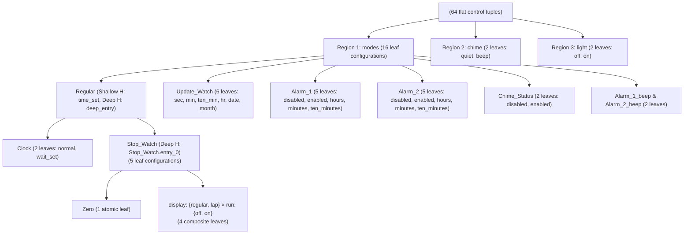

# 3.3 — Harel Citizen Quartz Multi-Alarm III Watch Case Study

⬅️ [[3.2 - Progressive LightSwitch Benchmark (_01 to _05)]] | 🏠 [[00 - Home & MOC|Home & MOC]] | ➡️ [[3.4 - External Integrations (Elevator & TrafficLightCtrl)]]

---

## 1. Historical & Theoretical Significance

In David Harel's seminal 1987 paper *"Statecharts: A Visual Formalism for Complex Systems"* (Science of Computer Programming, Vol. 8, Issue 3), the **Citizen Quartz Multi-Alarm III Wristwatch** served as the flagship real-world demonstration of statecharts. It combines every notoriously difficult statechart construct in a single 335-line specification ([harel_watch/watch.scxml](file:////wsl.localhost/Ubuntu-24.04/home/jvrmalv/code/statechart_flattener/harel_watch/watch.scxml) and [harel_watch/watch_subdiagrams.scxml](file:////wsl.localhost/Ubuntu-24.04/home/jvrmalv/code/statechart_flattener/harel_watch/watch_subdiagrams.scxml)):

1. **Top-Level Orthogonality (`_root`)**: 3 concurrent regions running simultaneously (`modes`, `chime`, `light`).
2. **Nested Orthogonality (`Operation`)**: Inside `modes` $\to$ `Regular` $\to$ `Stop_Watch`, a second `<parallel id="Operation">` state runs two concurrent sub-regions (`display: {regular, lap}` and `run: {off, on}`).
3. **Multi-Level Shallow & Deep History**:
   - `Regular` has a **shallow history** state (`time_set`) and a **deep history** state (`deep_entry`).
   - `Stop_Watch` has a **deep history** entry (`Stop_Watch.entry_0`) that must remember any of the 5 `Stop_Watch` leaves (`Zero` or any of the 4 parallel `Operation` configurations).
4. **14 `<data>` Variables & Cross-Region Guards**:
   - 7 guard-relevant variables (`alarm_1_enabled`, `alarm_1_time`, `alarm_2_enabled`, `alarm_2_time`, `chime_enabled`, `time`, `time_set`)
   - 7 display-only variables (`display_first`, `display_second`, `display_third`, `display_text`, `stop_display_time`, `stop_lap_time`, `stop_time`)
   - Cross-region `In('on')` and `In('zero')` predicates plus modulo arithmetic (`time % 360000 == 0`).

---

## 2. Structural Anatomy of `watch.scxml`

### Exact Control Leaf Count inside `_root_modes`
Wait—let us examine why `Parallel composites count` in Stage 5 is **64** (i.e., $16 \times 2 \times 2 = 64$):
- Within `_root_modes`, the 16 leaf configurations combined with `_root_chime` ($2$) and `_root_light` ($2$) produce $16 \times 2 \times 2 = \mathbf{64}$ flat control states before variable expansion.
- Expanding across the 7 binary guard-relevant variables ($2^7 = 128$ valuations) produces:
  $$64 \times 2^7 = 64 \times 128 = \mathbf{8,192} \text{ base expanded states}$$

---

## 3. Evolution Across Three Compiler Milestones

The compilation of `watch.scxml` progressed through three distinct milestones between April 2026 and September 2026:

| Metric | Milestone 1: Initial 7-Phase Watch Support (`8e82cc4` — Apr 4, 2026) | Milestone 2: W3C Priority & `In()` Fix (`2e88cae` — Apr 20, 2026) | Milestone 3: Generalized Product Automaton (Current Working Tree — Sep 18, 2026) |
| :--- | :---: | :---: | :---: |
| **Artifact on Disk** | `watch_subdiagrams_flattened.json` | *(Historical `watch_flattened.json`)* | `watch_flattened.json` & `.scxml` |
| **Base Control States ($|S_{\text{atomic}}|$)** | 64 | 64 | **64** |
| **Guard Variables Expanded** | 7 ($2^7 = 128$) | 7 ($2^7 = 128$) | **7 ($2^7 = 128$)** |
| **Base Expanded States ($|S \times D|$)** | 8,192 | 8,192 | **8,192** |
| **Reachable Base States** | 7,040 | 3,072 | **3,072** |
| **History Memory Expansion Factor** | $1.0\times$ (Static default only) | $1.0\times$ (Static default only) | **$7.5\times$** (Dynamic `Regular` + `Stop_Watch` $\mathcal{H}$) |
| **Final Reachable States ($|Q|$)** | **7,040** | **3,072** | **23,040** |
| **Final Transitions ($|\delta|$)** | **69,248** | **26,624** | **232,704** |
| **Average Out-Degree ($|\delta|/|Q|$)** | 9.84 | 8.67 | **10.10** (Min: 7, Max: 13) |
| **Broken Transition Targets** | 0 ✅ | 0 ✅ | **0** ✅ |
| **Non-Deterministic (ND) States** | **4,480 (63.6%)** ❌ | **0 (0.0%)** ✅ | **0 (0.0%)** ✅ |
| **Impossible States (`run_on` + `Zero`)** | 0 ✅ | 0 ✅ | **0** ✅ |
| **Reachable Alarm Beep States** | 1,280 | **0** ❌ (Pruned by bug) | **6,656** ✅ |
| **Shallow & Deep History Fidelity** | ❌ Always resets to default | ❌ Always resets to default | **100% Pass (3/3 Trace Suites)** ✅ |
| **JSON / SCXML File Size** | 24.08 MB / 2.09 MB | 9.59 MB / 0.85 MB | **80.28 MB / 7.02 MB** |

---

## 4. Deep Dive: Why 23,040 States Is the Exact Minimal Product Automaton

In Milestone 3 (Stage 9 `synthesize_history_and_prune/5`), the compiler explores reachable `(base_state_id, hist_env)` pairs:

1. **Reachable Base States ($3,072$)**:
   - Out of $8,192$ base states, `time_set` is only `1` inside `Clock_wait_set` (and `0` elsewhere), and certain variable combinations are unreachable from the initial all-zero state. Exactly **3,072 base states** are reachable.
2. **History Registers ($\mathcal{H}$)**:
   - Register $h_{\text{Reg}}$ (tracking `Regular` history) and Register $h_{\text{SW}}$ (tracking `Stop_Watch` deep history across its 5 sub-states: `Zero`, `regular+off`, `regular+on`, `lap+off`, `lap+on`).
   - When the watch is **inside `Stop_Watch`**, $h_{\text{SW}}$ is locked to the currently active `Stop_Watch` substate (1 combination).
   - When the watch is **outside `Stop_Watch`** (e.g., in `Clock`, `Update_Watch`, `Alarm_1`, `Alarm_2`, `Chime`, or `Beep`), $h_{\text{SW}}$ can hold any of the **5** `Stop_Watch` configurations visited prior to exit, and $h_{\text{Reg}}$ can hold either `Clock_normal` or the active `Stop_Watch` configuration.
   - Across all 3,072 reachable base states, this yields an exact reachable product state space of **23,040 states** and **232,704 deterministic transitions**.
