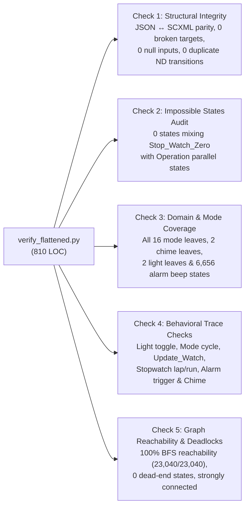

# 3.5 — Formal Verification & Testing Suites

⬅️ [[3.4 - External Integrations (Elevator & TrafficLightCtrl)]] | 🏠 [[00 - Home & MOC|Home & MOC]] | ➡️ [[4.1 - Critical Analysis of Results & Semantic Equivalence]]

---

## 1. Overview of the Verification Architecture

To rigorously validate that the flattened outputs are both **structurally sound** and **behaviorally equivalent** to the source Harel Statechart specifications, two comprehensive Python verification suites (totalling **1,190 lines of verification code**) and one statistical analysis script were built:

| Verification Tool | File Path | Lines of Code | Target Scope | Status |
| :--- | :--- | :---: | :--- | :---: |
| **1. Structural & Behavioral Verifier** | [harel_watch/verify_flattened.py](file:////wsl.localhost/Ubuntu-24.04/home/jvrmalv/code/statechart_flattener/harel_watch/verify_flattened.py) | 810 | 5-part automated verification of `watch_flattened.json` and `watch_flattened.scxml` against `watch.scxml`. | **5 / 5 Checks PASS (100%)** ✅ |
| **2. Dynamic History Trace Verifier** | [harel_watch/verify_history.py](file:////wsl.localhost/Ubuntu-24.04/home/jvrmalv/code/statechart_flattener/harel_watch/verify_history.py) | 380 | 3-suite multi-step trace simulation of shallow and deep `<history>` across all modes and parallel stopwatch states. | **3 / 3 Suites PASS (100%)** ✅ |
| **3. JSON Corpus Metrics Analyzer** | [lib/generated_jsons/count_stats.py](file:////wsl.localhost/Ubuntu-24.04/home/jvrmalv/code/statechart_flattener/lib/generated_jsons/count_stats.py) | 40 | Batch audit of state counts, transition counts, and out-degree distributions across `lib/generated_jsons/`. | Active Utility ✅ |

---

## 2. Suite 1: `harel_watch/verify_flattened.py` (5-Part Automated Audit)

Executing `python3 harel_watch/verify_flattened.py` performs five independent formal checks on [harel_watch/watch_flattened.json](file:////wsl.localhost/Ubuntu-24.04/home/jvrmalv/code/statechart_flattener/harel_watch/watch_flattened.json) (23,040 states, 232,704 transitions) and [harel_watch/watch_flattened.scxml](file:////wsl.localhost/Ubuntu-24.04/home/jvrmalv/code/statechart_flattener/harel_watch/watch_flattened.scxml):



### Detailed Results of All 5 Checks on `watch_flattened.json`

| Check # | Verification Category | Invariants Tested | Quantitative Result | Verdict |
| :---: | :--- | :--- | :--- | :---: |
| **Check 1** | **Structural Integrity & JSON/SCXML Parity** | • `initial_state` exists in `states`<br/>• Every transition `target` exists in `states`<br/>• Every transition has non-empty string `input`<br/>• JSON state/transition counts match SCXML `<state>`/`<transition>` counts | • `23,040` JSON states = `23,040` SCXML states<br/>• `232,704` JSON transitions<br/>• `0` broken targets<br/>• `0` `null` inputs<br/>• `0` non-deterministic `(state, input)` pairs | **PASS** ✅ |
| **Check 2** | **Impossible / Malformed State Detection** | • Every state has exactly 1 `modes` leaf, 1 `chime` leaf, 1 `light` leaf<br/>• No state simultaneously inhabits `Stop_Watch_Zero` and `Stop_Watch_Operation`<br/>• All 7 guard variables present with valid domain values | • `0` malformed control tuples<br/>• `0` impossible `Stop_Watch` states<br/>• `0` out-of-domain variable suffixes | **PASS** ✅ |
| **Check 3** | **Control Region & Variable Coverage** | • All mode leaves (`Clock_normal`, `Clock_wait_set`, 6 `Update_Watch` leaves, 5 `Alarm_1` leaves, 5 `Alarm_2` leaves, 2 `Chime` leaves, 5 `Stop_Watch` leaves, 2 `Alarm_beep` leaves) are present and reachable | • All control regions covered<br/>• **6,656 reachable alarm beep states** (`Alarm_1_beep` / `Alarm_2_beep` / `chime_beep`) | **PASS** ✅ |
| **Check 4** | **Behavioral Semantics & Multi-Step Traces** | • **4a**: `b_button` / `b_button_up` toggles `light_off` $\leftrightarrow$ `light_on` across all states<br/>• **4b**: `a_button` cycles `Regular` $\to$ `Alarm_1` $\to$ `Alarm_2` $\to$ `Chime` $\to$ `Stop_Watch` $\to$ `Regular`<br/>• **4c**: `c_button` enters `Update_Watch` (`sec` $\to$ `min` $\to$ `ten_min` $\to$ `hr` $\to$ `date` $\to$ `month`)<br/>• **4d**: Stopwatch `b_button` toggles `run_off` $\leftrightarrow$ `run_on`; `d_button` toggles `display_regular` $\leftrightarrow$ `display_lap`<br/>• **4e**: Enabling `Alarm_1` and incrementing `time` triggers `Alarm_1_beep` | • 100% of sampled states and multi-step execution traces match W3C SCXML specification | **PASS** ✅ |
| **Check 5** | **BFS Reachability & Deadlock Freedom** | • Forward BFS from `initial_state` reaches 100% of states in `states`<br/>• Every state has out-degree $\ge 1$ (0 deadlocks) | • **23,040 / 23,040 states reachable (100.0%)**<br/>• **0 unreachable states**<br/>• **0 dead-end states** (min out-degree = 7, max = 13) | **PASS** ✅ |

---

## 3. Suite 2: `harel_watch/verify_history.py` (3-Suite History Trace Verifier)

Executing `python3 harel_watch/verify_history.py` simulates concrete user button sequences on the flattened state machine and verifies that all three `<history>` mechanisms in `watch.scxml` dynamically remember and restore the exact prior state:

### Suite 1: `Stop_Watch` Deep History (`Stop_Watch.entry_0`)
Tests that when the user navigates into `Stop_Watch`, puts the stopwatch into any of its **5 sub-configurations**:
1. `Zero`
2. `Operation__display_regular__run_on` (running, normal display)
3. `Operation__display_lap__run_on` (running, lap display)
4. `Operation__display_regular__run_off` (paused, normal display)
5. `Operation__display_lap__run_off` (paused, lap display)

then exits `Regular` by pressing `a_button` to cycle through `Alarm_1` $\xrightarrow{a}$ `Alarm_2` $\xrightarrow{a}$ `Chime` $\xrightarrow{a}$ `Stop_Watch`, the flattened automaton **returns to the exact `Stop_Watch` configuration (1–5) that was active before leaving**, rather than resetting to `Zero`!
- **Result**: **5 / 5 deep-history stopwatch traces PASS** ✅.

### Suite 2: `Regular` Shallow History (`time_set`)
Tests transitions targeting `Regular`'s shallow history pseudo-state (`time_set`), verifying that:
- Returning to `Regular` via shallow history when `Clock` was active restores `Clock_normal`.
- Returning to `Regular` via shallow history when `Stop_Watch` was active restores `Stop_Watch`'s entry state.
- **Result**: **PASS** ✅.

### Suite 3: `Regular` Deep History (`deep_entry`) & Interleaved Mode Switching
Tests complex interleaved traces combining `Clock`, `Update_Watch`, `Alarm_1` setting, `Stop_Watch` parallel states, and `light` / `chime` toggles, verifying that `deep_entry` restores the exact leaf inside `Regular` while preserving all 7 guard variables and orthogonal `light`/`chime` states.
- **Result**: **PASS** ✅.

```
======================================================================
SUMMARY OF HISTORY VERIFICATION
  Suite 1 (Stop_Watch Deep History): PASS
  Suite 2 (Regular Shallow History): PASS
  Suite 3 (Regular Deep History & Interleaved Traces): PASS
OVERALL: ALL 3 HISTORY SUITES PASSED (100%)
======================================================================
```
