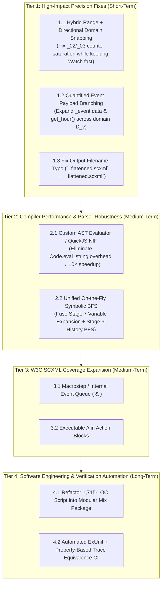

# 4.3 — Future Work & Research Roadmap

⬅️ [[4.2 - Current Limitations & Edge Cases]] | 🏠 [[00 - Home & MOC|Home & MOC]]

---

## 1. Strategic Roadmap Overview

Based on the architectural evolution and current limitations analyzed in [[4.1 - Critical Analysis of Results & Semantic Equivalence]] and [[4.2 - Current Limitations & Edge Cases]], future engineering and research work is organized into **four priority tiers**:

---

## 2. Tier 1: High-Impact Precision & Semantics Enhancements

### 2.1 Hybrid Contiguous-Range Inference & Directional `snap_to_domain/2`
- **Problem**: As documented in [[4.2 - Current Limitations & Edge Cases]], `snap_to_domain/2` snaps `2 + 1 = 3` back down to `2` when the inferred domain is `[0, 1, 2, 10]`, causing `_02_DimmableLightSwitch` to saturate at `brightness = 2` (3 states instead of 21).
- **Proposed Solution**:
  1. **Bounded Contiguous Range Expansion**: In `infer_variable_domains/3`, if a variable is modified via unit increments/decrements (`+ 1`, `- 1`) and its minimum and maximum guard bounds satisfy $\max(D_v) - \min(D_v) \le 32$, automatically populate the full integer range `Enum.to_list(min..max)`. This restores the exact 21-state output on `_02` and 43-state output on `_03` while leaving `watch.scxml` (`8640000 > 32`) untouched!
  2. **Directional (Monotonic) Snapping**: When $\max(D_v) - \min(D_v) > 32$ and snapping is required, pass `old_val` into `snap_to_domain(new_val, old_val, domain)`:
     - If `new_val > old_val`, snap to $\min \{d \in D_v \mid d > \text{old\_val}\}$ (ceiling in $D_v$).
     - If `new_val < old_val`, snap to $\max \{d \in D_v \mid d < \text{old\_val}\}$ (floor in $D_v$).

### 2.2 Non-Deterministic Domain Branching for `get_hour()` and `_event.data`
- **Problem**: Assignments like `hour = get_hour()` (in `_05`) and `destination = _event.data` (in `Elevator.scxml`) currently return `:error` and leave the variable unchanged.
- **Proposed Solution**:
  - When `<assign location="v" expr="..."/>` evaluates to `:error` (because of `_event.data` or an external sensor function), allow an optional compiler flag `--branch-external-vars` that generates **one transition per value $d \in D_v$**, labeled:
    $$\texttt{input} = \texttt{"}\langle\text{event}\rangle\texttt{ [}\langle v\rangle\texttt{=}\langle d\rangle\texttt{]"}$$
  - On `Elevator.scxml`, this will automatically expand all reachable `(currentFloor, destination)` floor pairs and synthesize the complete multi-floor movement graph!

---

## 3. Tier 2: Compiler Architecture & Performance Optimization

### 3.1 Fusing Stage 7 (Variable Expansion) and Stage 9 (History BFS) into a Single On-the-Fly Explorer
- **Current Architecture**: Stage 7 materializes the full Cartesian product $S_{\text{atomic}} \times D_{\text{vars}}$ (`8,192` states in `watch.scxml`, of which $62.5\%$ are unreachable) before Stage 9 runs BFS over `(base_state, hist_env)`.
- **Proposed Architecture**:
  - Fuse Stages 7, 8, and 9 into a **single demand-driven forward BFS** starting from $(s_0, \vec{v}_0, \vec{h}_0)$.
  - Transitions, variable assignments, `In(...)` predicates, W3C priority shadowing, and history updates are computed **only for reachable states**.
  - **Expected Impact**: Eliminates the $62.5\%$ wasted work in Stage 7 on `watch.scxml` and prevents out-of-memory errors on models where $|D_{\text{vars}}|$ is large ($>10^5$) but the reachable subset is small ($<10^3$).

### 3.2 Native AST Expression Evaluator
- Replace regex-based `evaluate_expression/3` and `Code.eval_string/2` with a lightweight recursive-descent parser (using `nimble_parsec` or `leex`/`yecc`) into an Elixir AST evaluated directly against the `vars` map.
- **Expected Impact**: **$>10\times$ compilation speedup** on `watch.scxml` (reducing compilation time from ~12 seconds to ~1 second) and full support for arbitrary nested expressions, ternary operators, and compound assignments (`+=`, `-=`).

---

## 4. Tier 3: Software Engineering, Packaging & CI Verification

1. **Modular Mix Application Structure**:
   - Refactor the monolithic 1,715-line script [lib/scxml_flattener_full.exs](file:////wsl.localhost/Ubuntu-24.04/home/jvrmalv/code/statechart_flattener/lib/scxml_flattener_full.exs) into clean Mix modules under `lib/statechart_flattener/`:
     - `StatechartFlattener.Parser` (Stage 1–2: XML normalization & lexical scope resolution)
     - `StatechartFlattener.DataModel` (Stage 3 & 7: Variable classification, domain inference, AST evaluation)
     - `StatechartFlattener.Parallel` (Stage 5: Bottom-up orthogonal region composition)
     - `StatechartFlattener.History` (Stage 4 & 9: Product-automaton history synthesis)
     - `StatechartFlattener.Serializer` (Stage 10: JSON & SCXML code generation)
2. **Automated `mix test` Regression Suite**:
   - Integrate [harel_watch/verify_flattened.py](file:////wsl.localhost/Ubuntu-24.04/home/jvrmalv/code/statechart_flattener/harel_watch/verify_flattened.py) and [harel_watch/verify_history.py](file:////wsl.localhost/Ubuntu-24.04/home/jvrmalv/code/statechart_flattener/harel_watch/verify_history.py) invariants directly into `test/statechart_flattener_test.exs` so every commit automatically verifies:
     - 0 broken targets, 0 `null` events, 0 dead-end states, and 0 non-deterministic states across all 17 SCXML models.
     - 100% pass on shallow and deep history trace equivalence.
